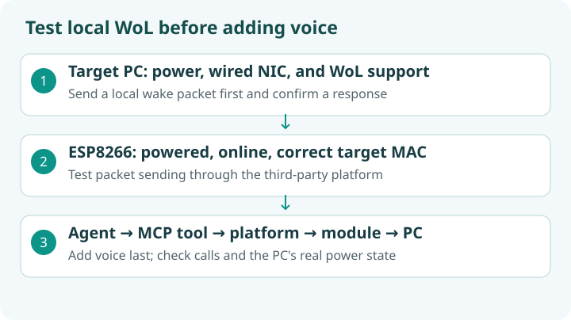

# Wake a computer over the network

This example by **ZongZiTongXue (粽子同学)** uses ESP8266 to send Wake-on-LAN packets on a local network, triggered through a third-party MCP platform. It covers waking a computer; successful wake does not imply remote shutdown support.

## Check prerequisites {#scope}

- The PC's network card, motherboard, and relevant power state support WoL, enabled according to hardware/OS instructions.
- The PC remains connected to power and uses wired networking as required by this design.
- The wake module remains powered and online, with a working network path to the PC. Check client isolation.
- Third-party platform, module firmware, and MCP bridge have identified versions and sources.

<figure class="source-figure">

<figcaption>Verify local-network wake before adding voice control. Click to view full size.</figcaption>
</figure>

## 1. Test locally first {#local}

Use a verifiable local WoL tool to confirm the PC wakes. Record its wired NIC MAC, target network, and power state. Voice integration will not fix a failed local wake.

MAC/IP addresses identify network configuration; they are not a platform account or module UUID. Do not put them in unrelated fields.

## 2. Module and platform {#module}

The ESP8266-specific binary and checksum are available below. It is not xiaozhi-esp32 firmware and cannot be replaced with an arbitrary main-firmware release. Source must be requested from the author; this is not a self-contained official open-source solution. Check provenance, then follow its documentation to flash, provision, and verify the module is online.

The workflow depends on external services such as `xiaozhimcp.top`. Before use, verify the current HTTPS address, operator, and credential purpose. Then configure an endpoint with your own account according to the platform's instructions.

<SourceMaterials article="DOC-36" />

## 3. From platform to voice {#verify}

1. Use the platform's test button first and confirm the PC wakes.
2. Connect your agent and confirm discovery of the corresponding wake tool.
3. Trigger it with an explicit device name, checking real call records and the PC's power state.
4. Test module power loss, router changes, and different PC sleep/shutdown states.

A successful tool response does not establish that the PC actually started. Successful wake also does not establish remote shutdown.

## Next steps {#sources}

Learn the [MCP quickstart](../../mcp/quickstart.md), then choose a maintenance approach for your network.
