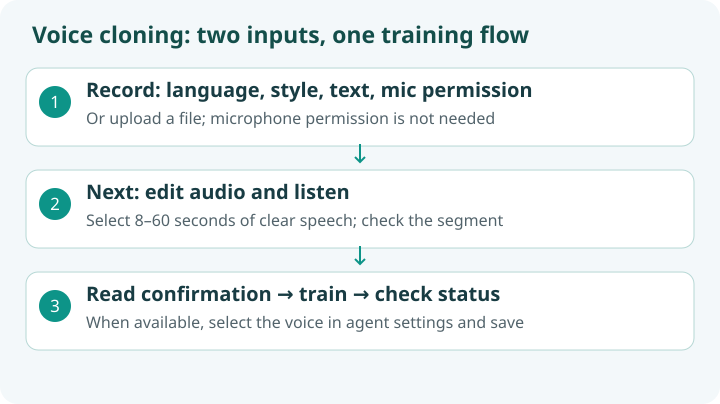
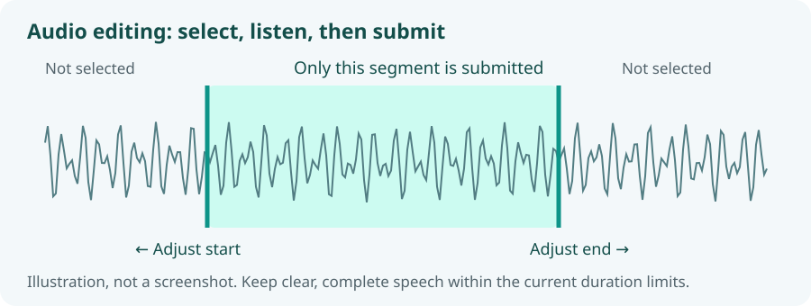

# Voice cloning: record, train, and use

Voice cloning involves activation, audio preparation, training submission, waiting for availability, and selecting the voice in an agent. Check account eligibility and current costs before recording.

## Preparation {#scope}

- Sign in to the [voice-cloning page](https://xiaozhi.me/console/voice-clone) and complete identity verification as currently required. The current implementation restricts purchases and renewals by minors.
- Read the purchase terms, price, validity period, and training allowance. Use recordings you are authorized to provide.
- Prepare a quiet room, reliable microphone, and browser that can record/upload audio. Grant microphone permission when recording is needed.

Current page notices determine prices, allowances, and processing time.

## 1. Check activation {#purchase}

Follow the available purchase or renewal flow, then return to the voice list to check status. Payment, training status, and voice availability are different stages. Repeated purchases do not accelerate an order being processed.

## 2. Prepare training audio {#audio}

Choose either recording or upload. The current source-file limit is **50MB**; select **8–60 seconds** in the browser before conversion to WAV and submission. Avoid background music, overlapping speakers, clipping, and obvious echo. Do not cut off speech at either end.

<figure class="source-figure">

<figcaption>Voice cloning: two audio inputs share the same training workflow. Click to view full size.</figcaption>
</figure>

### Record with a microphone {#record}

1. Select microphone recording and choose the language, style, and text you will actually read.
2. Allow microphone access when starting. If access fails, check microphone permissions and input selection in the browser's address-bar site settings.
3. Read clearly in a quiet room, stop, and listen back. Rerecord if the content or capture is unsuitable. Continue to audio editing, adjust the selection, and listen again.

### Upload existing audio {#upload}

1. Choose a local file the browser can decode and confirm its language.
2. Continue to audio editing. Select a continuous, clear passage in the waveform and drag the boundaries to adjust it.
3. Listen to the selection and check language and duration against current requirements before training.

<figure class="source-figure">

<figcaption>Audio-selection illustration. Content outside the boundaries is not submitted; listen to the selected segment first. Click to view full size.</figcaption>
</figure>

The selection illustration explains trimming; it is not a screenshot. Listen to the actual selected segment before submitting either recorded or uploaded audio.

## 3. Submit, wait, and handle failures {#training}

1. Confirm the audio, language, style, and duration. Read and accept the page's confirmation, then start cloning.
2. Watch the training state in the list, refreshing manually if needed. Keep the original audio for troubleshooting.
3. On failure, read the error and distinguish recording conditions, format/duration, allowance, and service state. Follow the available recovery options.
4. After successful training, preview the sample and set a recognizable alias.

There is no guaranteed five-minute completion time. Refreshing is not retraining. Retry, appeal, and refund options depend on the current status and service rules.

## 4. Select the voice in an agent {#use}

Open the target agent's configuration, select the available cloned voice under role/voice settings, and save. Confirm that the device uses this agent, then start a new conversation. A successful preview on the cloning page does not mean the device has selected that voice.

## Verify the result {#verify}

The list shows the voice as available and its sample plays correctly. The agent has saved the intended voice, and the device actually uses it in an answer. If an available voice cannot be selected, check account, validity, and account-specific voice limits.

## Troubleshooting {#materials}

- **No recorded sound:** check browser permission, input device, and system microphone settings, then test a short recording.
- **Upload cannot be decoded:** check for a damaged file, use a browser-decodable format, and select a valid segment. Renaming an extension does not convert the file.
- **Training fails or the voice is unavailable:** retain the error, check audio requirements, training allowance, account, and expiry, then follow the available options.

Report status and steps without publishing identity documents or another person's original recordings.

## Next steps {#next}

To answer from your own material, continue with [Knowledge bases](./knowledge-base.md). For account ownership issues, see [Account troubleshooting](../faq/account-and-binding.md).
