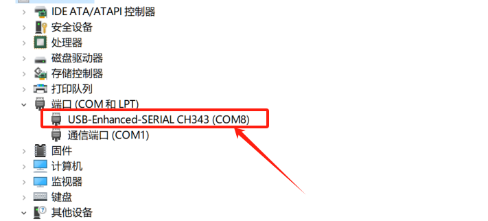

# Capture startup and fault logs

Logs distinguish startup, networking, activation, and audio failures. Capture first, then change conditions. The last line alone often misses the cause.

<a name="scope"></a>

## Preparation {#scope}

Prepare a data cable and suitable serial tool. Identify native USB versus a USB-UART bridge. Obtain drivers from the board or chip manufacturer; a historical driver bundled with one tool is not required for every device.

<a name="port"></a>

## 1. Find the port {#port}

Compare port lists before and after connecting the device. Windows offers Device Manager; on macOS/Linux, use your tool's serial-port list. Identify the connection by USB/UART labels and manufacturer instructions rather than “left” or “right” port.

Ports can change between ROM download mode and application runtime. Capture the normal-startup port. A visible port alone does not establish running firmware.

<figure class="source-figure">

[](../../public/images/zh/doc-23-image-001.webp)

<figcaption>Finding a serial port in Windows Device Manager. COM numbers vary by computer.</figcaption>
</figure>

<a name="capture"></a>

## 2. Connect and restart {#capture}

1. Close flashing pages, IDE monitors, and terminals occupying the port.
2. Select the port. The basic board generally uses **115200 baud, 8 data bits, no parity, 1 stop bit**; check other boards' configurations.
3. Open the port, briefly press RESET/EN, and capture from startup.
4. Reproduce the problem once and retain context before, during, and after it.
5. Export plain text with hardware, firmware version, and actual steps.

With ESP-IDF installed, use:

```sh
idf.py -p COM5 monitor
```

Replace `COM5` with your port and exit with Ctrl+]. You do not need to install a whole SDK just for logs. Alternatively, use [pySerial miniterm](https://pyserial.readthedocs.io/en/latest/tools.html#module-serial.tools.miniterm): install `pyserial` in a separate Python environment, then run `python -m serial.tools.miniterm COM5 115200` with your actual port. Exit with Ctrl+].

<a name="read"></a>

## 3. What to inspect first {#read}

| Stage | Look for |
| --- | --- |
| Startup | Chip, version, board, Flash/PSRAM, partitions, and first initialization error |
| Network | Scans, connections, disconnects, repeated provisioning |
| Activation/OTA | HTTP status and activation state; keep credentials private |
| Conversation | Connection, recording, playback, tool calls, and where resets occur |

Keep unfamiliar errors verbatim. Do not discard the first failure while retaining only cascading errors.

<a name="verify"></a>

## Verify the result {#verify}

The text includes startup version and reproducible fault context, allowing another person to follow the sequence. Redact Wi-Fi passwords, endpoint tokens, phone numbers, and unnecessary device identifiers. Screenshots do not replace copyable error text.

<a name="materials"></a>

## Tools and next steps {#materials}

Download serial tools from their maintainers' official releases. For writing firmware, return to [Flashing](../firmware/flashing.md). Do not type random control commands into the serial window.
