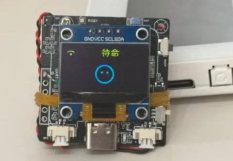
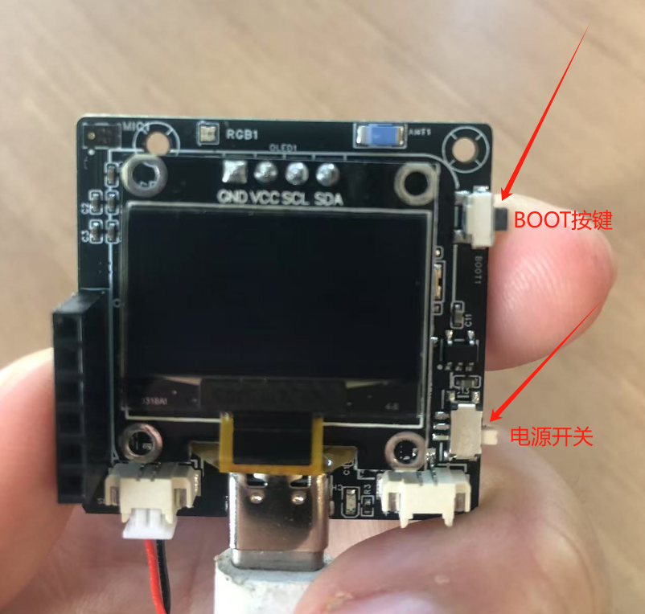

# Xmini-C3, V3, and 4G variants

Xmini is a hardware family. Its Wi-Fi, V3, and 4G variants are different boards. Their firmware determines the circuit support, audio pins, and network initialization.

<figure class="source-figure">

<figcaption>Xmini-C3 board.</figcaption>
</figure>

## 1. Identify your board {#scope}

| Family | v2.6.0 source directory | Check |
| --- | --- | --- |
| C3 Wi-Fi | `xmini/c3` | ES8311, OLED, and original pins |
| C3 V3 | `xmini/c3-v3` | I2S/I2C/PA pins differ from the original |
| C3 4G | `xmini/c3-4g` | Cellular module, SIM, power, and network setup |

For example, the original Codec's I2C uses GPIO3/4, while V3 uses GPIO0/1. Do not infer a new board's wiring from an older photo. Refer to the [versioned board directory](https://github.com/78/xiaozhi-esp32/tree/4de00aed740595a8713b01f8332b9b2cf30685bc/main/boards/xmini).

<figure class="source-figure">

<figcaption>BOOT, switch, and USB positions on the original board; do not use this photo to infer V3 pins.</figcaption>
</figure>

## 2. Install firmware {#flash}

Find the exact board and variant in the [online builder](../../firmware/online-builder.md) or [official releases](../../firmware/downloads.md). A release package may include a manufacturer prefix; check its directory and full name together. If an older v1 device needs legacy firmware, use [v1.9.4](../../firmware/releases/v1.9.4.md) only when it matches the hardware.

Follow [Flashing firmware](../../firmware/flashing.md) to enter that board's download mode. C3 BOOT and USB behavior differs from the basic S3. Use the board documentation and matching source rather than copying the S3 GPIO0 wiring.

## 3. Connect, bind, and talk {#use}

For Wi-Fi boards, use hotspot or BluFi provisioning according to the build, then continue with [device binding](../../getting-started/wifi-and-binding.md). For 4G, check the module, SIM, and network state before obtaining the six-digit device code.

Test microphone capture and playback using the button before testing wake words. Current C3 builds can use compatible lightweight WakeNet models; the blanket claim that C3 never supports offline wake words is outdated. See [Wake words](../../development/wake-words.md) and the actual model for available phrases.

Check battery-voltage measurement, charging ports, sleep, and buttons for the specific hardware revision. A battery icon does not establish battery sensing on every variant.

## Verify the result {#verify}

Confirm the version and variant match the hardware, then test display, audio, network, and conversation. Test battery and wake features only where the hardware and build support them. Record results for the specific revision rather than extending one board's result to the whole family.

## Next steps {#sources}

Use the photos to identify buttons and ports on the relevant revision. Pins and behavior are defined by the board documentation and matching firmware. The open hardware is maintained in [Xia Ge's Xmini project](https://oshwhub.com/tenclass01/xmini_c3). For a C3 breadboard, see [C3 with ES8311](../breadboard-esp32-c3.md).
