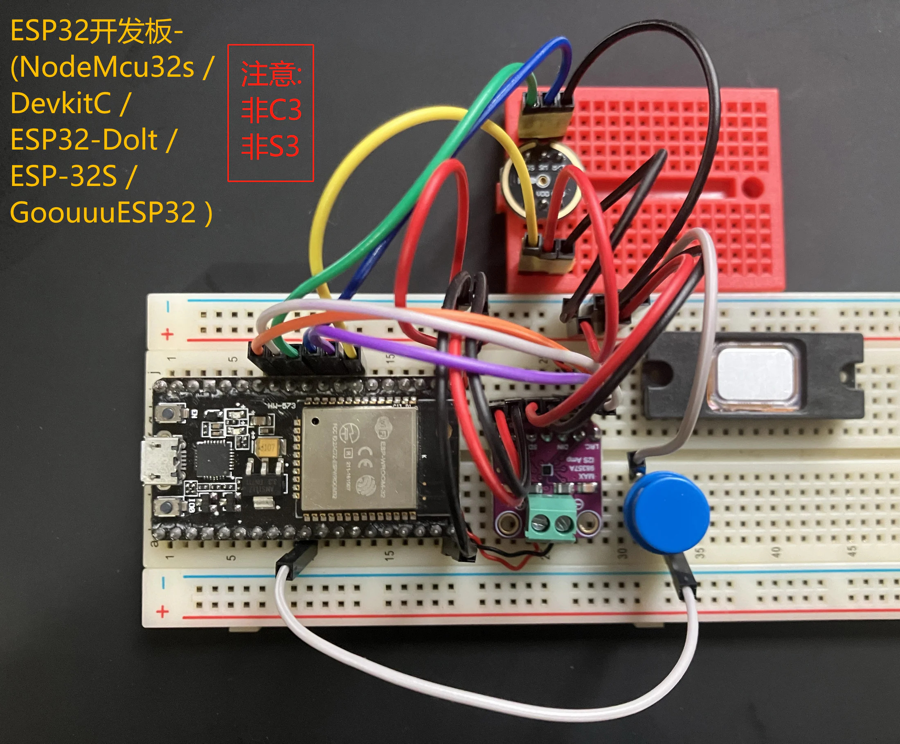
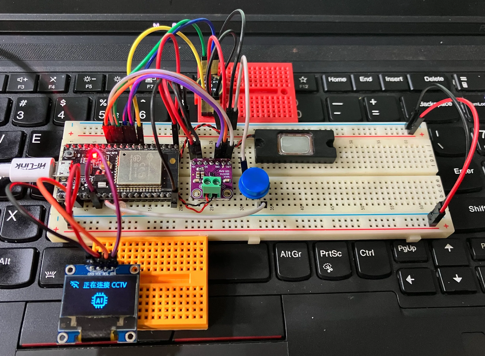
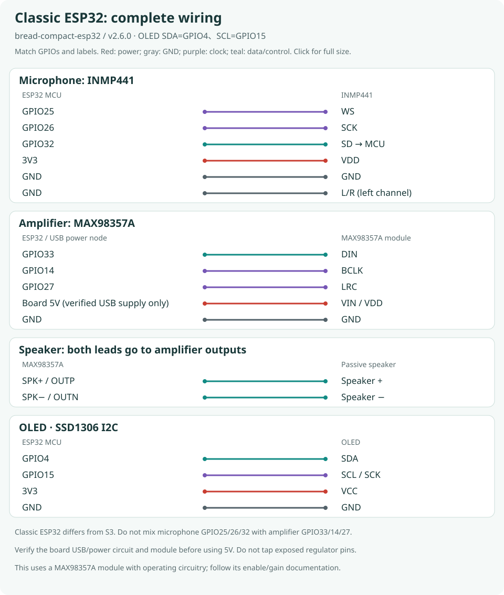
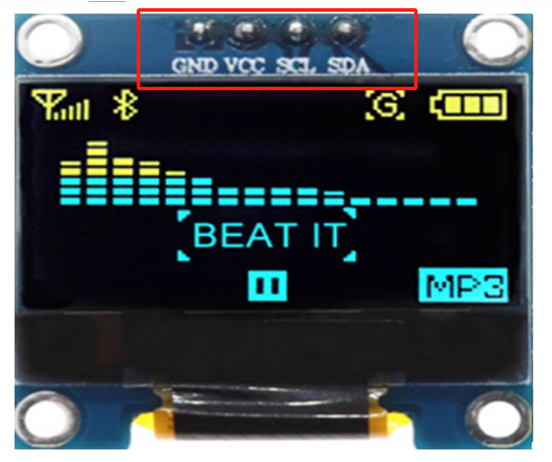

# Classic ESP32 breadboard

This build uses the classic ESP32, rather than ESP32-S3 or C3. A 4MB device without PSRAM is still useful, but cannot be promised every feature that requires PSRAM or more resources.

## See the finished build {#finished-overview}

<figure class="source-figure">

<figcaption>Classic ESP32 prototype.</figcaption>
</figure>

<figure class="source-figure">

<figcaption>Classic ESP32 assembly example.</figcaption>
</figure>

## 1. Identify the target {#scope}

The corresponding board directory is `bread-compact-esp32`. Check the ESP32 module, actual Flash capacity, microphone, amplifier, and display driver. Select the correct 128×64 or 128×32 variant.

## 2. Check wiring against the current code {#wiring}

<figure class="source-figure wiring-figure">

<figcaption>Signal connections for firmware v2.6.0; this is not a physical header layout.</figcaption>
</figure>

### Check each connection

| Function | Current default GPIO |
| --- | --- |
| Microphone WS / SCK / data input | 25 / 26 / 32 |
| Amplifier data / BCLK / LRCK | 33 / 14 / 27 |
| OLED SDA / SCL | **4 / 15** |
| BOOT / external ASR input | 0 / 19 |

Check the OLED GPIOs against the [versioned config.h](https://github.com/78/xiaozhi-esp32/blob/4de00aed740595a8713b01f8332b9b2cf30685bc/main/boards/bread-compact-esp32/config.h). Confirm power, L/R selection, and amplifier load against the specific modules' documentation.

<figure class="source-figure">

<figcaption>OLED pin labels; use the firmware pin table on this page for GPIO connections.</figcaption>
</figure>

## 3. Install and test in stages {#build}

1. Start with [online building and flashing](../firmware/online-builder.md), selecting the exact board and memory layout.
2. Follow [Flashing firmware](../firmware/flashing.md), then check startup, display, and prompt audio.
3. Complete [Wi-Fi provisioning and device binding](../getting-started/wifi-and-binding.md). Test a conversation with the button first.
4. Enable wake-word detection only when resources and model support permit it. A board without PSRAM cannot directly use a configuration that requires PSRAM.

For an external voice module, check voltage levels and triggering separately in [External ASR modules](./external-wake-module.md). 4G and custom PCBs also require separate board configurations. Use traceable releases for firmware.

## Verify the result {#verify}

The firmware should report the correct chip, memory, and variant. Check the display, audio, network, and button-initiated conversation. Record supported and unsupported features separately; a working device does not imply feature parity with S3 or P4.

## Next steps {#sources}

Use the prototype photos to identify the build. For changes to pins or components, continue with [Custom boards](../development/custom-board.md).
