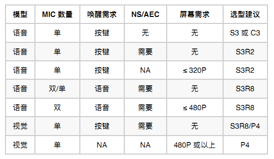

# Hardware design considerations

Hardware design combines chip resources, power, audio, and mechanics. Define the required functions first, then check the design against component documentation and test results.

## 1. Select for signals and loads {#scope}

Define voice, display, camera, network, low-power, and update requirements before choosing the chip, Flash/PSRAM, Codec, and peripherals. Cross-check models, AFE, and wake capabilities with [firmware support](./supported-boards.md).

<figure class="source-figure">

<figcaption>Chip and voice-capability selection chart. Consider microphone count, wake detection, audio processing, and display together; check support against the firmware version used.</figcaption>
</figure>

## 2. Power and noise {#power}

Evaluate peak loads from Wi-Fi/cellular transmission, playback, and backlight rather than idle current alone. Check regulator headroom, return paths, decoupling, connectors, and power switching. Distinguish supply ripple, digital coupling, grounding, and mechanical causes of audio noise.

Battery protection, charging, boost conversion, and operation while charging are separate functions. Define the path using [Battery power](./battery-power.md); a USB port does not imply all these capabilities.

## 3. Microphone capture and playback {#acoustics}

Record microphone sensitivity, signal-to-noise ratio, power, and interface requirements. Check the acoustic opening, cavity, and orientation. Design the speaker together with its enclosure, limiting direct coupling into the microphone and feedback from enclosure vibration.

[AEC](../development/audio-and-aec.md) needs a real reference signal and appropriate isolation. More microphones or a software checkbox do not guarantee results. Design headphone/line outputs separately from speaker amplification; see [Audio output](./audio-output.md).

## 4. Design for production and maintenance {#test}

Provide an identifiable hardware revision, programming/debug interfaces, fault logs, and recovery path. Test conversation, playback, camera, peak network activity, and extended operation. Sleep, reconnection, and low battery require more than one startup test.

Record the test environment, volume, distance, enclosure revision, and pass criteria in the board README. After circuit changes, rerun previously passed tests. Another board with the same chip is not a substitute.

## Verify the result {#verify}

A design review should trace every promised capability to the circuit, component documentation, and specific tests. A selection chart does not replace firmware compatibility checks, electrical specifications, or actual testing.

## Next steps {#next}

For parts, see [Choosing hardware](./choosing-hardware.md). To integrate firmware, see [Custom boards](../development/custom-board.md).
