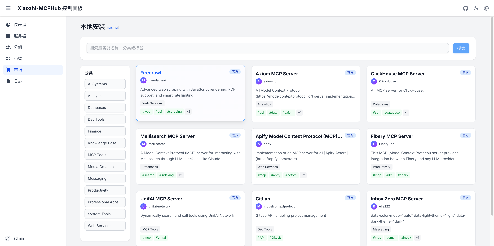

# 社区 MCP 工具与服务

这里列出几种社区 MCP 工具，帮助选择维护方式。它们不是官方服务，也不代表本站已运行、审查或保证所有外部功能。

## 先选择维护方式 {#scope}

| 类型 | 适合的情况 | 要核对 |
| --- | --- | --- |
| 本地桌面启动器 | 在自己的 Windows 电脑保持工具在线 | 发布来源、依赖、睡眠和进程状态 |
| 自部署管理平台 | 管理多个端点与服务 | 版本、数据库、鉴权、更新与备份 |
| 第三方托管服务 | 由供应商持续运行 | 凭据用途、费用、维护主体和退出方式 |

## 小智 MCPTools {#mcptools}

作者：**粽子同学**。项目入口：[xiaozhi-MCPTools](https://github.com/ZongZiTongXue/xiaozhi-MCPTools)。安装前查看作者的发布说明，确认当前版本和分发入口。

安装细节由作者维护。遇到权限或 401 错误时，先检查发行说明与鉴权配置；先用[官方最小例子](../mcp/quickstart.md)验证端点，工具不能启动时保存实际错误。

### 安装与首次接入

[作者维护的安装指南](https://kcn80f4hacgs.feishu.cn/docx/HErcd1F8LoKjDnx3O0Pcktd3nPI)提供发行包、依赖安装和界面步骤；[安装视频](https://v.douyin.com/PK-NmFdDIsE/)可配合查看。按所下载版本的要求安装，不把另一版安装器的口令或权限设置套用到所有版本。

1. 完成该版本的初始化和 Python/依赖检查，确认没有安装错误。
2. 从目标智能体[复制 MCP 端点](../mcp/quickstart.md#endpoint)，在软件中添加地址，并填上能辨认该智能体的名称后保存。
3. 首次启动保留终端可见，点击启动 MCP，观察连接及子进程错误。
4. 回到同一智能体刷新工具列表，再要求调用一个明确的工具，核对实际结果。电脑休眠或软件关闭后，本机工具会离线。

安装或鉴权报错时保留具体错误和软件版本，按作者当前排错说明处理；不要仅因曾有某版 401 提示可忽略，就忽略所有鉴权失败。

## xiaozhi-mcphub {#mcphub}

维护者：**huangjunsen0406**。项目：[xiaozhi-mcphub](https://github.com/huangjunsen0406/xiaozhi-mcphub)，覆盖多端点、分组及服务管理。

<figure class="source-figure">

<figcaption>xiaozhi-mcphub 的工具市场列表：这是挑选服务的界面，不是连接架构图。</figcaption>
</figure>

自部署前看该版本 README，固定镜像/源码版本，修改默认凭据，确认数据库与备份。

## HyperChat / McpPipe 桥接组合 {#bridge-tools}

安装来源：[HyperChat 项目与发行入口](https://github.com/BigSweetPotatoStudio/HyperChat)、[McpPipe 项目及集成说明](https://github.com/onepy/Mcp_Pipe-Xiaozhi-All#readme)。两端版本要相容，安装与启动命令按各自 README。

1. 在 HyperChat 的 MCP 网关功能中创建网关，从“允许 MCPs”中选择本次要提供的工具，保存后复制生成的网关 URL。
2. 在 McpPipe 选择与该 URL 匹配的传输模式；使用 Streamable HTTP 网关时，选择相应模式，并把网关 URL 填到远端服务地址栏。
3. 将[小智智能体的 MCP 端点](../mcp/quickstart.md#endpoint)填到小智接入点栏。网关 URL 和小智端点用途不同，不要互换。
4. 点击连接并保持两端运行；在小智控制台刷新工具列表，再进行一次明确调用。新增工具后，还要在网关的允许列表中启用它并重新连接。

通用 stdio、SSE、HTTP 配置及排错见[桥接指南](../mcp/connect-existing-servers.md)。

## 闪猫联网搜索 {#search}

闪猫科技提供托管搜索服务。使用前确认当前 HTTPS 入口、费用与维护主体，再决定是否交给它自己的 MCP 凭据。

需要使用时从[服务维护说明](https://my.feishu.cn/docx/DN0ndX1JaoP4EWx1FBWcdCmcnoc)核对当前 HTTPS 入口与维护主体，再判断是否将自己的 MCP 凭据交给服务。只想掌握通用搜索接入时看[搜索示例](../mcp/examples/web-search.md)。

<SourceMaterials article="DOC-43" />

## 接入前检查 {#materials}

使用维护者的当前发行包，确认所需权限、依赖和退出方式。分享配置或截图前移除 MCP 端点、API Key 和个人信息。

## 怎么确认可用 {#verify}

从自己的账号完成“端点连接 → 工具发现 → 明确调用 → 正确返回”，再验证重启、断网和退出。公开反馈只提供经遮盖的日志，第三方问题优先到相应维护者入口。
