# 太空人故事机改造案例

本案例把特定故事机外壳、按键及部分原板电路与 S3 语音模块结合。原机同名不代表 PCB 一致，因此先识别板号和电源路径，再考虑复刻。

<figure class="source-figure">

<figcaption>原太空人故事机与改造目标。</figcaption>
</figure>

## 1. 拆机与识别 {#scope}

断电、断开电池后拍下原板正反面、所有连接器和电池规格。记录原扬声器、按键、电源开关、充电芯片和稳压器，确认哪些电路要保留。

<figure class="source-figure">

[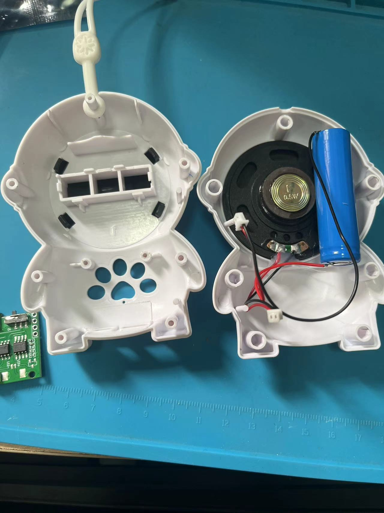](../../../public/images/zh/doc-44-image-003.jpg)

<figcaption>示例样机 PCB 拆解照片，仅适用该板修订。</figcaption>
</figure>

<figure class="source-figure">

[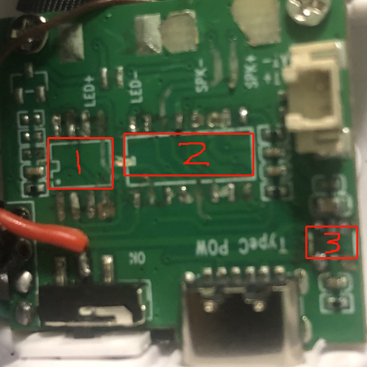](../../../public/images/zh/doc-44-image-004.webp)

<figcaption>原板另一视角；拆除器件前必须确认电路。</figcaption>
</figure>

原方案涉及拆除原 PCB 上器件。必须先确认器件功能和目标板修订，不能仅凭图中的红框在另一批板上照拆。

## 2. 新语音部分 {#audio}

下面是这套样机的音频信号接线，与 `xiaozhi-esp32 v2.6.0` 基础 S3 板型对应。不同批次故事机 PCB 仍需单独核对。

| 模块 | 模块引脚 | ESP32-S3 GPIO |
| --- | --- | --- |
| INMP441 | WS | 4 |
| INMP441 | SCK | 5 |
| INMP441 | SD（输出到主控） | 6 |
| MAX98357A | DIN（主控输出） | 7 |
| MAX98357A | BCLK | 15 |
| MAX98357A | LRC | 16 |

示例样机表将 INMP441 的 VDD 接 3V3，GND 与 L/R 接 GND；功放 VCC 与 SD 接 3V3，GND 与 GAIN 接 GND，扬声器分别接功放输出正、负端。

**这里记录的是示例样机的 3V3 功放分支**，仍需核验稳压器余量、功放模块版本和声道/增益设置；不能不检查电源就照接。新搭建独立语音部分时，优先使用[基础面包板](../../hardware/breadboard-esp32-s3)完整且一致的供电方案，不混用两个方案的电源线。

对照照片识别模块与焊点，再分别核对信号、电源和固件。原有功放、扬声器或麦克风能否复用，要有电路依据；功放扬声器输出不能接共地耳机。

<figure class="source-figure">

[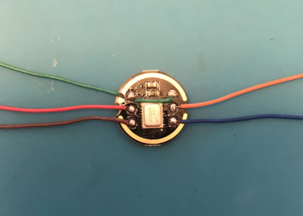](../../../public/images/zh/doc-44-image-005.webp)

<figcaption>INMP441 麦克风模块。</figcaption>
</figure>

<figure class="source-figure">

[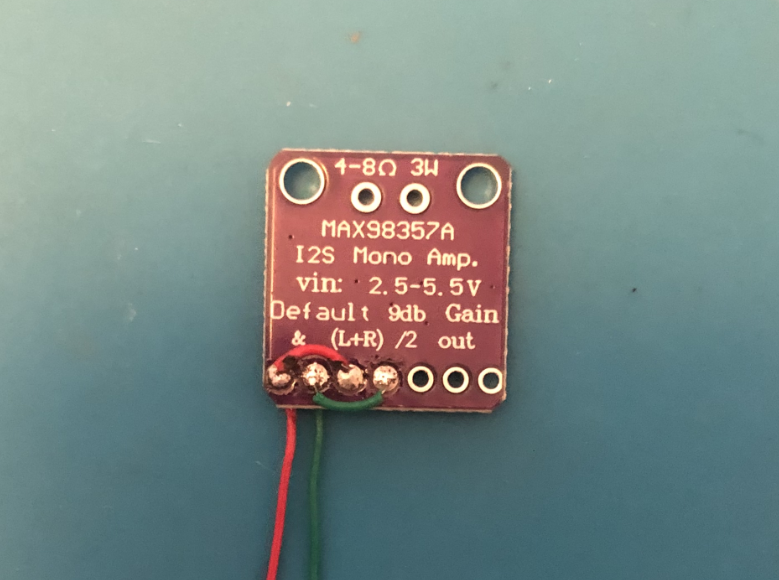](../../../public/images/zh/doc-44-image-006.webp)

<figcaption>MAX98357A 功放模块。</figcaption>
</figure>

<figure class="source-figure">

[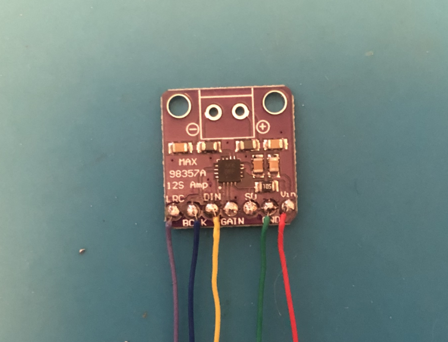](../../../public/images/zh/doc-44-image-007.webp)

<figcaption>原功放模块接线参考。</figcaption>
</figure>

<figure class="source-figure">

[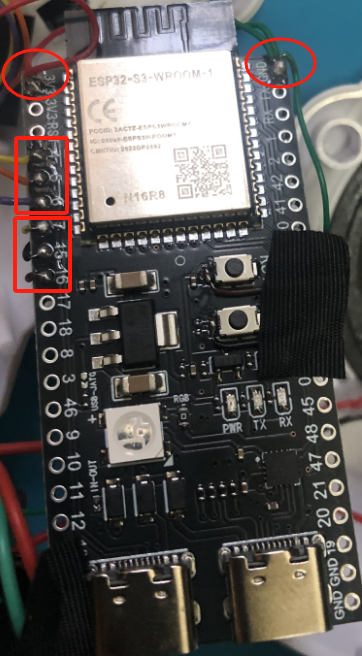](../../../public/images/zh/doc-44-image-008.webp)

<figcaption>原语音模块组装。</figcaption>
</figure>

<figure class="source-figure">

[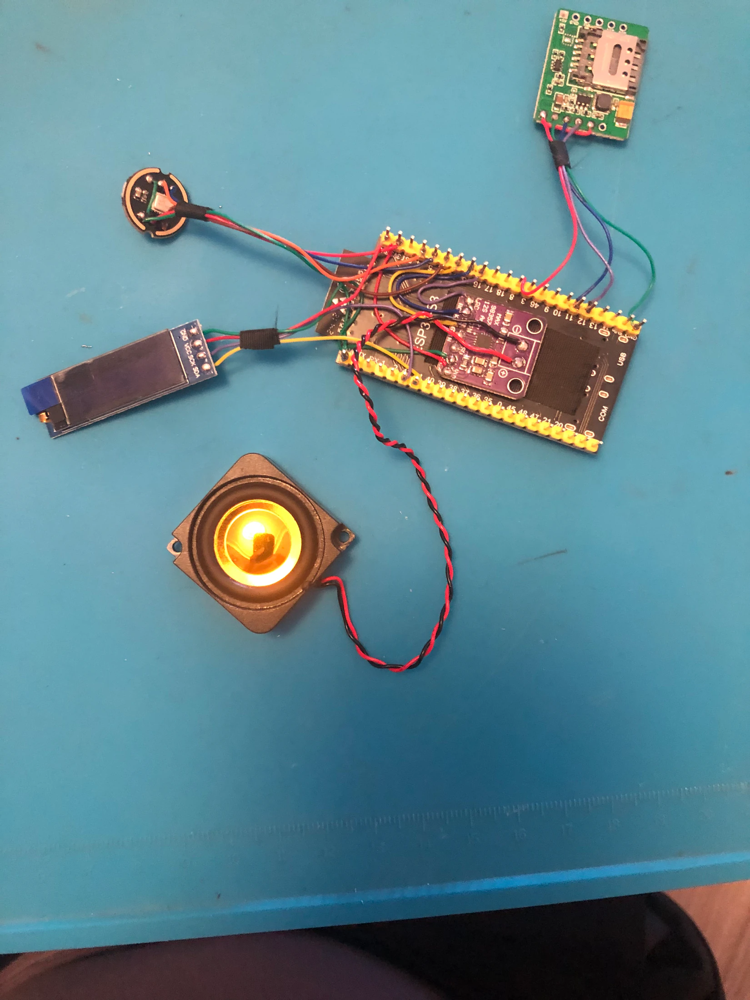](../../../public/images/zh/doc-44-image-009.webp)

<figcaption>原语音部分的另一视角。</figcaption>
</figure>

## 3. 电池、USB 和原板复用 {#power}

先画出电池、保护、充电、升压、主板和 USB 的完整路径，区分 `BAT`、`VIN`、`OUT` 与 `GND`。照片中的焊点只适用于同一 PCB 修订，不推断同色线或相同外壳就等价。

在不复用未经确认的充电路径时，先让新语音部分通过可靠 USB 电源独立运行。定制电池接法按[电池供电](../../hardware/battery-power)完成电气复核；不要把“能点亮”当作允许 USB 与电池同时接入的证明。

原板供电、充电和按键电路仍需按具体 PCB 实测；读取原表和核对 GPIO 不等于完整改造方案已经通过电气与真机验证。

<figure class="source-figure">

[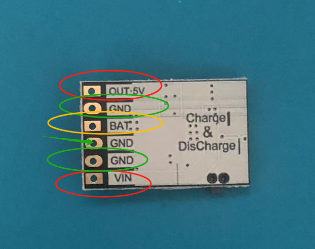](../../../public/images/zh/doc-44-image-012.webp)

<figcaption>样机电源模块的 OUT 5V、BAT、VIN 和 GND 标注。输入、电池与输出不能互换；接线前核对具体模块原理图。</figcaption>
</figure>

## 4. 按键、固件与装壳 {#build}

1. 用独立硬件先验证显示/提示音、麦克风、联网和对话。
2. 测量原按键电路，确认信号电平和有效方向，再在[独立板型](../../development/custom-board)中适配。
3. 将电源、按键和语音部分逐项接入，每步记录结果，不直接套用旧 v0.3/v0.5 的行为。
4. 固定线束，检查麦克风孔、扬声器、按键行程和 USB 空间，再装壳。

<figure class="source-figure">

[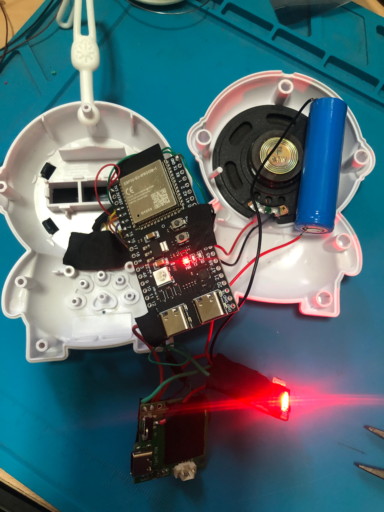](../../../public/images/zh/doc-44-image-015.webp)

<figcaption>原改造样机完成状态。</figcaption>
</figure>

<figure class="source-figure">

[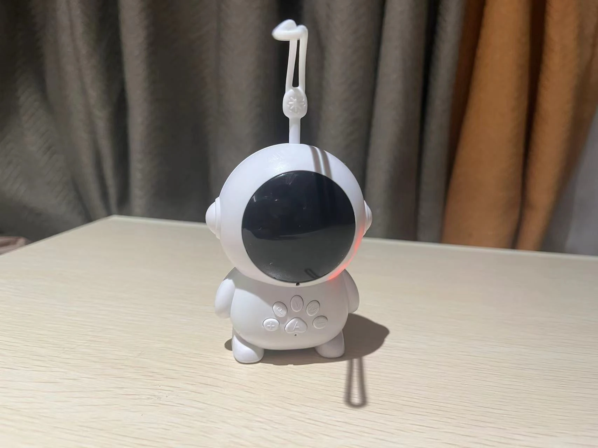](../../../public/images/zh/doc-44-image-016.webp)

<figcaption>装壳效果。</figcaption>
</figure>

<figure class="source-figure">

[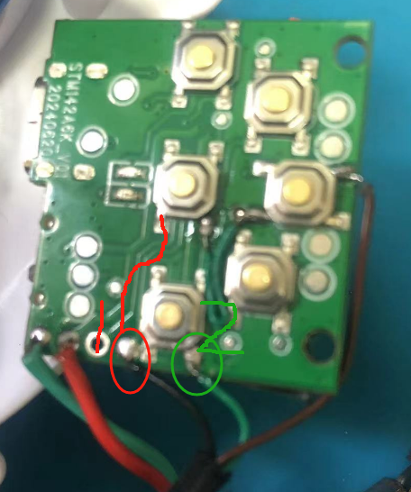](../../../public/images/zh/doc-44-image-013.webp)

<figcaption>这块样机按键板上的信号引出点：先测量导通、有效电平和原板供电，再接入主控。</figcaption>
</figure>

<figure class="source-figure">

[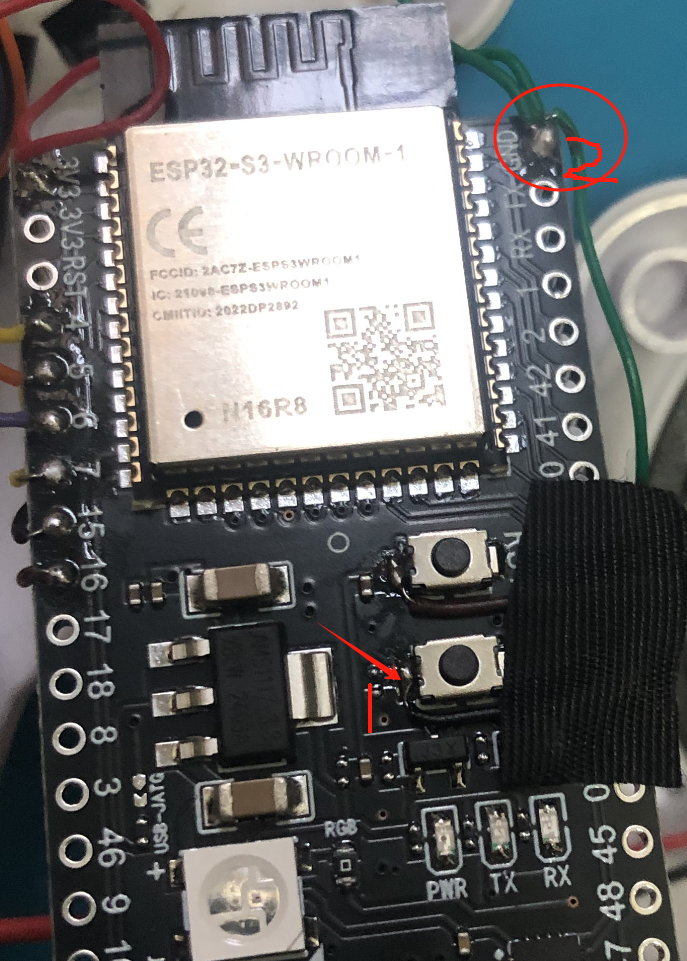](../../../public/images/zh/doc-44-image-014.webp)

<figcaption>样机的按键信号引到 S3 接口与 BOOT 附近。照片用于识别焊点，不能直接套用到其他 PCB 修订。</figcaption>
</figure>

## 怎么确认完成 {#verify}

具体 PCB 版本的电源和充电路径已经核验，固件能从干净配置重建；装壳前后都可对话，充电、休眠和恢复不会造成异常电平或复位。当前原型照片保留为案例证据，不代表所有批次已通过这些检查。

## 下一步 {#sources}

器件拆除和原板复用步骤只适用于核对过的 PCB 修订。需要从零开始时用[基础 S3](../../hardware/breadboard-esp32-s3)，其他硬件创意见[开源项目目录](../open-hardware)。
