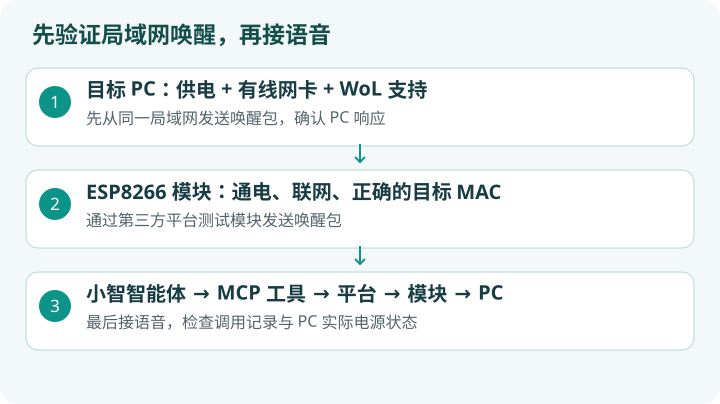

# 通过网络唤醒电脑的案例

本方案由**粽子同学**提供，用 ESP8266 在局域网发送 Wake-on-LAN 包，再通过第三方 MCP 平台触发。当前案例覆盖开机唤醒，不能由此推断已经实现远程关机。

## 先确认前提 {#scope}

- PC 的网卡、主板和所处电源状态支持 WoL，并已按硬件/系统说明启用。
- PC 保持接电并按原方案连接有线网络。
- 唤醒模块持续通电、联网，与目标 PC 的网络路径可达；检查客户端隔离。
- 第三方平台、模块固件和 MCP 桥接均有明确版本和来源。

<figure class="source-figure">

<figcaption>先验证局域网唤醒，再接语音。点击查看大图。</figcaption>
</figure>

## 1. 先做本地测试 {#local}

先在局域网使用可验证的 WoL 工具确认目标 PC 能唤醒。记录有线网卡 MAC、目标网络和电源状态；本地都不能唤醒时，接入语音不会解决问题。

MAC/IP 是配置线索，不等于平台账号或模块 UUID。不要把它们填进不相干的字段。

## 2. 模块与平台 {#module}

下方保留 ESP8266 专用二进制与校验值；它不是 xiaozhi-esp32 固件，不能从小智主固件 Release 随意选择替代。源码需联系作者，不能称作完全自包含的官方开源方案。核对来源后按其文档烧录、配网，并确认模块在线。

原流程依赖 `xiaozhimcp.top` 等外部服务；使用前确认当前 HTTPS 入口、维护者和凭据用途。确认 HTTPS 入口后，使用自己的账号按平台说明配置端点。

<SourceMaterials article="DOC-36" />

## 3. 从平台到语音 {#verify}

1. 先用平台测试按钮发送唤醒，确认 PC 响应。
2. 再连接自己的智能体，确认相应开机工具被发现。
3. 用明确的设备名称触发，核对真实调用记录和 PC 的电源状态。
4. 测试模块断电、路由变化和 PC 不同睡眠/关机状态。

只看到“调用成功”不能证明 PC 已经启动；当前方案也不能由开机成功推断远程关机能力。

## 下一步 {#sources}

先掌握[MCP 快速开始](../../mcp/quickstart)，再根据自己的网络选择维护方案。
