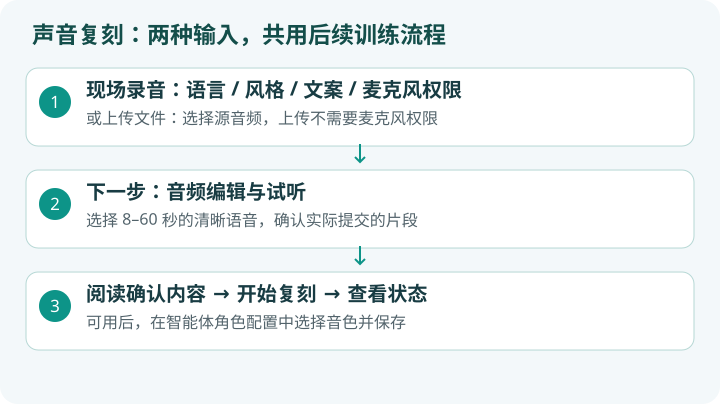
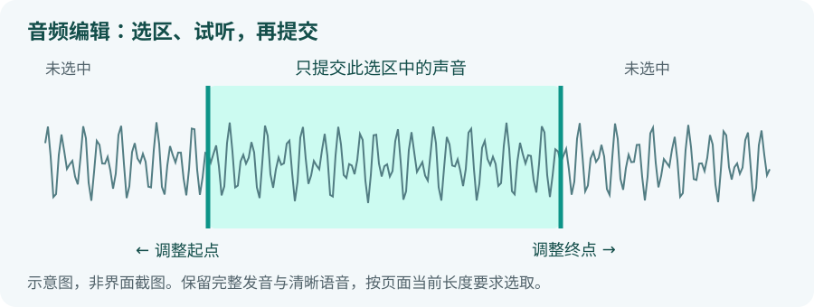

# 声音复刻：录音、训练与选用

声音复刻分为开通、准备音频、提交训练、等待可用和选入智能体几个阶段。先确认账号资格与当前费用，再开始录音。

## 准备工作 {#scope}

- 登录[声音复刻页面](https://xiaozhi.me/console/voice-clone)，按当前要求完成实名认证。当前实现限制未成年用户购买或续费。
- 查看购买须知、费用、有效期和可训练次数，使用自己有权提供的录音。
- 准备安静环境、稳定麦克风和能够录音/上传的浏览器；对浏览器授权只在确实需要录音时进行。

费用、次数与处理时长以当前页面提示为准。

## 1. 确认开通状态 {#purchase}

按页面提供的购买或续费流程操作，完成后回到音色列表核对状态。支付结果、训练状态与音色生效不是同一件事；重复点击购买不能加速正在处理的订单。

## 2. 准备训练音频 {#audio}

先选择一种方式准备音频。当前上传源文件上限为 **50MB**，浏览器选区为 **8–60 秒**，再转换为 WAV 提交。避免背景音乐、多人串音、削波和明显回声，开头结尾不要截断发音。

<figure class="source-figure">

<figcaption>声音复刻：两种输入，共用后续训练流程。点击查看大图。</figcaption>
</figure>

### 现场录音 {#record}

1. 选择麦克风录音，按页面选择实际朗读的语言、风格和文案。
2. 点击开始录音时允许浏览器使用麦克风。没有权限时，在浏览器地址栏的站点设置中检查麦克风权限和输入设备。
3. 在安静环境清晰朗读，停止后试听；内容或收音不合适时重新录制。点击“下一步”进入音频编辑，调整选区并再次试听。

### 上传已有音频 {#upload}

1. 选择本地音频文件，上传浏览器可解码的文件，并确认音频语言。
2. 点击“下一步”进入音频编辑，在波形中选取连续、清晰的有效语音，拖动左右边界调整。
3. 试听选区，确认语言和片段长度符合当前要求，再进入训练。

<figure class="source-figure">

<figcaption>音频编辑选区示意：边界外的内容不会提交，先试听所选片段。点击查看大图。</figcaption>
</figure>

选区示意用于说明裁剪关系，不是界面截图。录音和上传都应在提交前试听实际选区。

## 3. 提交、等待和处理失败 {#training}

1. 确认试听内容、语言、风格和选区长度，阅读页面的确认内容并勾选后，点击“开始复刻”。
2. 观察列表里的训练状态，必要时手动刷新；保持原音频以便排查。
3. 失败时阅读错误，区分录音条件、格式/长度、次数或服务状态，再按页面允许的方式处理。
4. 训练成功后试听示例，修改便于识别的别名。

不承诺“等五分钟一定完成”。刷新页面也不等于再次训练；是否允许重试、申诉或退款，以当前状态和页面规则为准。

## 4. 在智能体选用 {#use}

打开目标智能体的“配置”，在角色与声音相关设置中选择可用的复刻音色并保存。确认设备使用的是这个智能体，再开始一轮新对话。只在复刻页面试听成功，不代表设备已经选用了它。

## 怎么确认完成 {#verify}

列表状态可用，示例音频正常；智能体保存了目标音色，设备实际回答使用该音色。若列表可用却无法选择，检查账号、有效期和该账号的音色限制。

## 常见问题 {#materials}

- **没有录到声音**：检查浏览器权限、输入设备与系统麦克风设置，再录一小段试听。
- **上传后无法解码**：检查文件是否损坏，换成浏览器可解码的格式，再选择有效片段；仅改扩展名不会转换格式。
- **训练失败或音色不可用**：保留错误提示，检查音频条件、训练次数、账号和有效期，按页面允许的方式处理。

反馈时提供状态和操作步骤，不公开身份材料或他人的原始录音。

## 下一步 {#next}

需要让回答使用自己的资料时继续[知识库](./knowledge-base)；账号与归属问题查看[账号排查](../faq/account-and-binding)。
