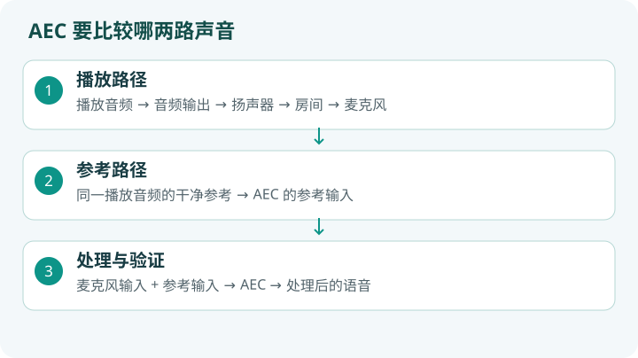

# 音频处理与回声消除 AEC

AEC 用来降低设备播放的声音被麦克风再次拾取的影响。是否有效取决于信号路径、参考音频、声学结构与固件/服务支持，不只是一个勾选框。

## 先确定路径 {#scope}

| 方案 | 必要核对 |
| --- | --- |
| 设备端 AEC | 芯片/PSRAM、AFE、板型支持及干净的播放参考信号 |
| 服务端 AEC | 固件的上行处理路径与服务端明确支持；当前配置标为不稳定 |
| 不启用 AEC | 先用按键或其他交互模式验证音频基础能力 |

本页依据[当前仓库 Kconfig](https://github.com/78/xiaozhi-esp32/blob/4de00aed740595a8713b01f8332b9b2cf30685bc/main/Kconfig.projbuild)。支持范围随版本变化，先检查所用版本的依赖条件。

<figure class="source-figure">

<figcaption>AEC 要比较哪两路声音。点击查看大图。</figcaption>
</figure>

这是信号关系图，不是新增麦克风或接线的电路图。参考输入的实际来源由板型与 Codec 实现决定。

## 1. 先验证基础音频 {#baseline}

关闭不必要的自定义处理，从低音量开始验证提示音、单独录音和对话。确认麦克风没有被遮挡、扬声器不直接冲向拾音孔、结构无明显振动传导。先记录不开 AEC 时的基准。

双麦克风不自动等于有播放参考，单纯增加一只麦克风也不能替代参考电路。

## 2. 按板型配置 {#configure}

使用[在线编译](../firmware/online-builder)时只选择该板提供的音频能力；本地构建时先选正确板型，再检查 `Enable AFE Audio Processing`、设备端/服务端 AEC 的依赖。

当前设备端 AEC 依赖受支持的芯片、PSRAM、AFE 和板型，参考信号由对应音频硬件提供。不要取消 Kconfig 依赖来给不具备参考通路的板强行打开。

编译环境和配置方法见[本地构建指南](./build-firmware)。

## 3. 用同一组条件比较 {#test}

1. 记录固件、音量、距离、外壳和电源。
2. 在安静环境测试设备播放时是否错误唤醒或把回答识别为用户话语。
3. 在支持的硬件上打开选定 AEC，保持其他条件不变再测。
4. 增加计划使用的背景噪声与音量，检查漏识别、打断和持续反馈。

“编译成功”和“能听到回答”都不能单独证明回声已消除。AEC、VAD 和对话打断是不同层面的功能，分别观察。

::: tip 完成标志
能说明采用哪条参考/处理路径，并给出同条件前后结果；没有通过 UI 样式或麦克风数量推断效果。
:::

## 下一步 {#next}

硬件结构参考[产品设计要点](../hardware/design-guidelines)，唤醒行为见[唤醒词](./wake-words)。配置选项的位置与依赖按所用固件、ESP-IDF 版本查看。
