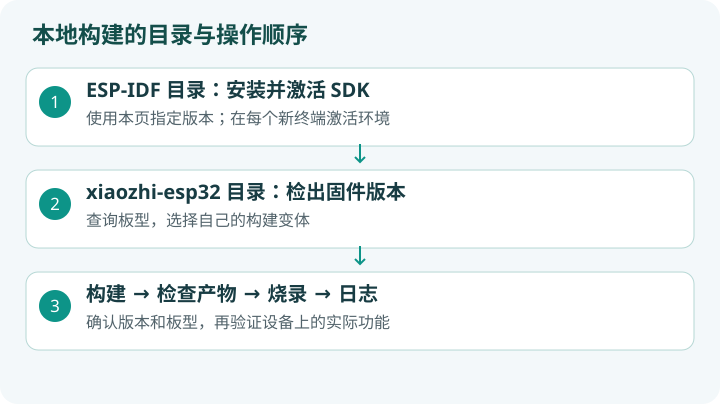

# 搭建环境与本地构建

需要改源码、自定义引脚或接入新硬件时，再搭建本地环境。只想使用现有板型，可先用[在线编译](../firmware/online-builder)。

## 版本与准备工作 {#scope}

本文使用 **小智固件 v2.6.0**，按[该版本 README](https://github.com/78/xiaozhi-esp32/blob/v2.6.0/README.md)选择 ESP-IDF：最低 6.0.1，建议 **`release/v6.1` 分支**。由于 C3 的已知问题，这里使用该分支，而不是 `v6.1` 发布 tag。

准备 Git、受 ESP-IDF 支持的 Python 和系统构建依赖。Windows、Linux、macOS 的安装前提不同，先按[乐鑫安装指南](https://docs.espressif.com/projects/esp-idf/en/stable/esp32s3/get-started/index.html)完成对应系统准备。下面以 ESP32-S3 为例。

<figure class="source-figure">

[](../../public/images/zh/firmware-build-flow.svg)

<figcaption>本地构建的目录与操作顺序。点击查看大图。</figcaption>
</figure>

## 1. 安装并激活 ESP-IDF {#install}

在自己选择的工作目录克隆 SDK；已有同名目录时先确认用途，不覆盖它：

```sh
git clone --branch release/v6.1 --recursive https://github.com/espressif/esp-idf.git
cd esp-idf
```

安装目标芯片工具并激活环境：

::: code-group

```powershell [Windows PowerShell]
.\install.ps1 esp32s3
.\export.ps1
```

```sh [macOS / Linux]
./install.sh esp32s3
. ./export.sh
```

:::

每个新终端都需要激活对应 SDK。使用安装管理器或 IDE 时，打开该安装对应的 ESP-IDF 终端，并确认它使用的是所选分支，而不是另一套旧 SDK。

```sh
idf.py --version
git rev-parse HEAD
```

第二条在 SDK 目录记录准确提交。分支会前进，保存 SDK 提交可让别人复现问题。换成 C3 等芯片时，需要安装对应目标的工具链。

## 2. 获取固件源码 {#source}

回到存放项目的工作目录，使用固定的正式 tag：

```sh
git clone --branch v2.6.0 https://github.com/78/xiaozhi-esp32.git
cd xiaozhi-esp32
git describe --tags --always
```

`--branch v2.6.0` 检出的是 tag，通常处于 detached HEAD；需要保存源码修改时先创建自己的工作分支。

## 3. 查询板型并构建 {#build}

在已激活 ESP-IDF 的终端、固件仓库根目录执行：

```sh
python scripts/build.py --list-boards
python scripts/build.py --list-languages
```

确认自己的板型目录和构建变体。以下命令仅适用于本文[基础 S3 / 128×32 OLED](../hardware/breadboard-esp32-s3)接线：

```sh
python scripts/build.py bread-compact-wifi --name bread-compact-wifi --language zh-CN
```

脚本根据该板 `config.json` 配置目标和变体，再生成构建产物。其他板型替换为它自己的目录与变体；不要通过改示例板的引脚却保留原固件身份来适配新硬件。

需要指定唤醒词时，先解析组件，再查询当前可用模型：

```sh
idf.py reconfigure
python scripts/build.py --list-wake-words
```

构建参数 `--wake-word` 可使用兼容模型名、`nihaoxiaozhi` 或 `disabled`。模型与芯片/内存必须相容；完整参数及当前能力以[版本化开发板指南](https://github.com/78/xiaozhi-esp32/blob/v2.6.0/docs/custom-board_zh.md)为准。

## 4. 检查产物并烧录 {#flash}

确认构建成功后，记录版本和变体。默认完整镜像位于 `build/merged-binary.bin`；需要分发包时，在构建命令追加 `--zip`，输出到 `releases/`。

已连接对应设备时，使用本次构建配置直接烧录和看日志。将示例端口改成自己的端口：

```sh
idf.py -p COM5 flash monitor
```

macOS/Linux 使用自己的 `/dev/…` 端口。日志监视器通常用 **Ctrl+]** 退出，重新烧录前先释放端口。使用其他工具分发镜像时，遵循[烧录指南](../firmware/flashing#image-types)，不猜应用文件偏移。

## SDK 切换与 Windows 排错 {#troubleshooting}

**更换 SDK 提交后**：在 SDK 目录更新其子模块，重新运行对应安装/激活脚本；在固件目录清理构建后重新选择板型。`fullclean` 清理的是构建目录，不会替你修复错误的板型或混用的终端。

```sh
# SDK 目录
git submodule update --init --recursive
# 然后重新激活 SDK；切回固件目录
idf.py fullclean
```

**Windows 的命令行过长**：在失败的同一工程和 ESP-IDF 终端中启用 response file 后重建：

```powershell
idf.py -D CMAKE_NINJA_FORCE_RESPONSE_FILE=ON reconfigure
idf.py build
```

清空 CMake 缓存后需重新启用。缩短工程路径也可能改善路径问题，但系统长路径选项不会直接提高整条命令行长度上限。不要通过关闭安全软件掩盖未定位的构建错误。

## 怎么确认完成 {#verify}

::: tip 完成标志
构建完成，启动日志的固件版本和板型符合预期，显示、音频、配网及一次对话通过。仅生成 `.bin` 不代表已验证硬件适配。
:::

## 下一步 {#next}

准备改变引脚时读[自定义开发板](./custom-board)；设备运行异常时按[常见问题](../faq/)采集信息，再反馈源码提交、SDK 提交和第一条实际错误。
