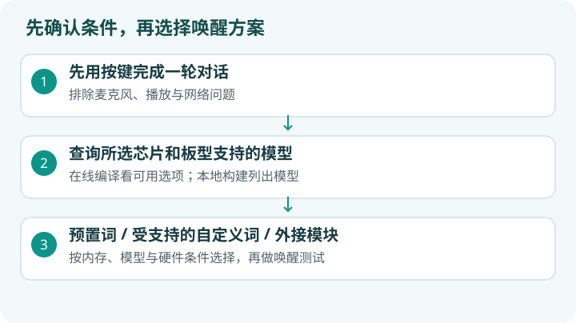

# 选择与修改唤醒词

先让按键对话正常，再配置唤醒。修改智能体名字、修改设备提示音和修改离线唤醒词是三件不同的事。

<a name="scope"></a>

## 选择方案 {#scope}

| 路径 | 当前固件的主要条件 |
| --- | --- |
| 预置 WakeNet | 按目标芯片选兼容模型；C3/C5/C6 使用轻量模型路径 |
| AFE + WakeNet | S3/P4/S31 等支持芯片，且满足 PSRAM 和构建条件 |
| 板载自定义词 | 当前 MultiNet 自定义路径要求支持芯片与 PSRAM |
| 外接 ASR | 独立语音模块、电平/触发及板级适配均需成立 |

这是选择入口，不是完整模型支持表。[该版本 Kconfig](https://github.com/78/xiaozhi-esp32/blob/4de00aed740595a8713b01f8332b9b2cf30685bc/main/Kconfig.projbuild)和已解析的 ESP-SR 模型是实际依据。

<figure class="source-figure">

[](../../public/images/zh/wake-word-choice.svg)

<figcaption>先确认条件，再选择唤醒方案。点击查看大图。</figcaption>
</figure>

<a name="online"></a>

## 1. 使用在线编译 {#online}

进入[固件编译](../firmware/online-builder.md)，选准确板型，再选择可用的唤醒词或关闭。没有任意文字输入不代表服务故障，当前提供的是该板兼容的构建选项。

<a name="preset"></a>

## 2. 本地查询预置模型 {#preset}

完成[构建环境](./build-firmware.md)和板型配置，解析组件后列出模型：

```sh
idf.py reconfigure
python scripts/build.py --list-wake-words
```

构建时 `--wake-word` 接受兼容模型名、`nihaoxiaozhi`、`hiesp` 或 `disabled`。语言和模型默认值由当前脚本处理；不要把 S3 的 `wn9_*` 名称直接套给 C3。

<a name="custom"></a>

## 3. 配置自定义词 {#custom}

在已选好板型的固件目录运行 `idf.py menuconfig`，进入 `Xiaozhi Assistant` 的唤醒相关选项。在支持的配置中选择 `Multinet model (Custom Wake Word)`。`Custom Wake Word` 使用空格分开的拼音，例如 `xiao tu dou`；显示名称单独设置。先使用默认阈值建立基准，再按误唤醒/漏唤醒结果调整。

阈值更灵敏不代表效果更好。需要安静、背景噪声、设备播放与多次唤醒的对照测试；也要核对资源空间和模型兼容。

<a name="verify"></a>

## 4. 安装并验证 {#verify}

烧录后重启，确认运行的是预期变体和词。分别测试按键、远近距离、常用音量、休眠后及设备播放期间。对话中能否唤醒/打断还有单独配置，不用一次待机成功证明所有状态有效。

<a name="next"></a>

## 下一步 {#next}

可用词与自定义能力由芯片、内存和模型决定，按上面的配置查询。资源受限的设备可看[外接 ASR](../hardware/external-wake-module.md)，不要先购买新模块再确认原板已有能力。
