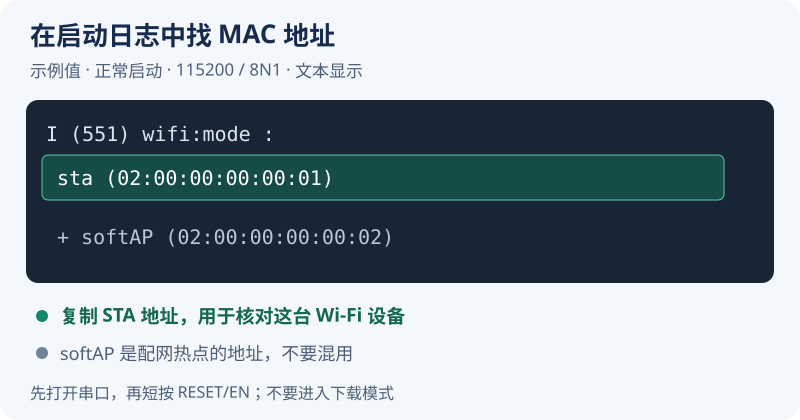

# 登录、找回账号与设备解绑

先确认自己原来使用的账号，再处理设备。换手机号登录、重刷设备或清空 Wi-Fi，都不会解除服务器上的设备绑定。

<a name="scope"></a>

## 选择入口 {#scope}

| 遇到的问题 | 从这里开始 |
| --- | --- |
| 手机验证码一直收不到 | [短信登录](#sms) |
| 忘了用户名或密码 | [恢复原账号](#recovery) |
| 需要换手机或绑定 Google | 登录后按账号设置操作 |
| 自己账号下的设备要转给别人 | [自主解绑](#unbind) |
| 买来的设备提示已绑定其他账号，无法联系原持有人 | [申请解绑](#ownership) |
| 不知道设备 ID 或 MAC 地址 | [获取设备信息](#device-information) |
| 多台设备需要解绑 | [批量申请表](#batch) |

<a name="sms"></a>

## 1. 短信与 Google 登录 {#sms}

在[官网控制台](https://xiaozhi.me/console/)核对国家/地区区号，按当前页面完成图形验证和短信发送。检查号码、信号、短信拦截和发送间隔，不重复猛点发送。

当前实现对 **非 +86 的未注册号码**引导使用 Google 登录；已有国际号码账号的条件可能不同。遇到明确的页面提示时按提示处理，不把等待十分钟当成通用办法。

Google 登录、手机号登录和 GitHub 认证不是同一个功能。GitHub 是登录后的[绑定与权益认证](../console/github-verification.md)，不能靠输入 GitHub 用户名找回小智账号。

<a name="recovery"></a>

## 2. 恢复原账号 {#recovery}

1. 确认原来用的是哪个手机号、Google 账号或用户名。空白的新账号不代表旧数据消失。
2. 如果仍能用短信/Google 登录原账号，先登录，再到账号设置修改密码或绑定方式。
3. 无法自行恢复时，发邮件至 **[xiaozhi.ai@tenclass.com](mailto:xiaozhi.ai@tenclass.com)**，按下表说明情况。邮件正文写明出错步骤和可回复的联系方式，不发送密码或短信验证码。

| 情况 | 邮件标题 | 提供的信息 |
| --- | --- | --- |
| 知道用户名，忘记密码，且无法用已绑定方式登录 | `【找回密码，用户名 XXX，设备ID XXX】` | 原用户名、设备 ID |
| 用户名和密码都忘了，且无法用已绑定方式登录 | `【找回用户名，设备ID XXX，激活日期 XXX】` | 设备 ID、激活日期；日期不确定时注明大致时间 |

设备信息的获取方法见[下文](#device-information)。无法取得某项时如实说明，不猜填；工作人员可能需要进一步核对归属。申请不等于已经恢复账号。

<a name="unbind"></a>

## 3. 自己账号下的设备解绑 {#unbind}

1. 登录[控制台](https://xiaozhi.me/console/)，找到设备所属的智能体。
2. 打开该智能体的 **设备**列表，按设备名称、板型和 MAC 地址核对目标。MAC 显示为遮盖形式时，可点击该项复制完整地址，在自己的记录中比对。
3. 找到该设备的 **解绑**操作。手机上若操作在卡片下方，向下滚动；不要误选删除整个智能体。
4. 阅读确认框：**解绑也会删除这台设备的对话记录**。确认是正确设备、已保留自己需要的记录后，再确认解绑。
5. 让接收方重启设备，按[配网与绑定](../getting-started/wifi-and-binding.md#bind)取得新的六位设备验证码，并绑定到自己的账号。

解绑设备与删除智能体不同，不需要为了转移一个设备清除整个智能体。是否需要重新配网，取决于设备原来的网络是否仍可用。

<a name="ownership"></a>

## 4. 已绑定其他账号的设备 {#ownership}

买来的开发套件、模组或二手设备可能在出售、退货或回收前已经绑定过账号。**先联系卖家或原持有人，请对方按上面的步骤解绑**。无法联系时，可提交人工解绑申请：

1. 按[获取设备信息](#device-information)记录 MAC 地址、能取得的设备 ID，以及设备型号和固件版本。
2. 发邮件至 **[xiaozhi.ai@tenclass.com](mailto:xiaozhi.ai@tenclass.com)**。
3. 单台设备的邮件标题使用 `【解绑设备，设备ID XXX，MAC地址 XXX】`，把占位文字替换成实际信息。无法取得设备 ID 时标明“无法读取”，在正文说明原因；不要把六位绑定验证码填进去。
4. 正文写明“购买的设备提示已绑定他人账号，无法联系原持有人”，附设备信息、报错内容和购买/取得设备的情况。支持人员要求补充材料时，在同一邮件中回复。
5. 收到处理完成的回复后，重启设备，再按[六位设备码绑定步骤](../getting-started/wifi-and-binding.md#bind)添加到自己的账号；若仍失败，回复原邮件并附新的错误提示。

可复制下面的正文后填写：

```text
申请：解除设备与原账号的绑定
原因：设备提示已绑定其他账号，无法联系原持有人
设备 ID：
MAC 地址：
设备型号与固件版本：
购买/取得设备的情况：
当前错误提示：
```

申请需要人工核查，不保证发送邮件后立即解绑。重刷固件、清空 Wi-Fi 或恢复出厂设置不能替代服务器端解绑。设备标识和证明材料只提供给支持人员，不发到公开 Issue 或群聊。

<a name="batch"></a>

### 多台设备如何申请 {#batch}

1. [下载设备批量解绑申请表（XLSX）](https://github.com/78/xiaozhi-docs/releases/download/tutorial-assets-2026-11-14/doc-16-file-001.xlsx)。
2. 保留表头 **设备ID、MAC地址**，每行填写一台设备，核对两项属于同一台设备。无法取得的项目注明原因，不编造编号。
3. 将填好的表格作为邮件附件，发送至同一支持邮箱，标题为 `【解绑设备】`；正文说明设备来源与申请原因。
4. 按回复补充资料，处理后逐台验证能否重新绑定。

<SourceMaterials article="DOC-16" />

<a name="device-information"></a>

## 5. 获取设备 ID 与 MAC 地址 {#device-information}

**设备 ID、MAC、启动 UUID 和六位绑定验证码不是同一个字段**。六位验证码用于添加设备；MAC 是形如 `02:00:00:00:00:01` 的地址；启动日志中的 UUID 也不要直接当作后台的数字设备 ID。

### 设备 ID

设备仍能正常对话时，可以尝试问“我的设备 ID 是什么？”，记录设备提供的编号。无法对话、没有返回编号，或只能取得 UUID 时，写明实际情况，把 MAC 和相关日志提供给支持人员核对，不为取得 ID 先擦除或重刷设备。

### MAC 地址

- **能登录原账号**：打开智能体的设备列表，点击 MAC 地址项复制完整地址。
- **不能登录原账号**：通过自己的电脑读取设备启动日志，按下面的步骤操作。

1. 用 USB 数据线连接设备的日志串口。关闭占用该端口的在线烧录页、IDE 监视器和其他串口工具。
2. 按[串口日志教程](./serial-logs.md#capture)打开实际端口，基础 ESP32 方案通常为 **115200、8 数据位、无校验、1 停止位**，关闭 HEX 显示。
3. 打开端口后短按 **RESET/EN**，让固件正常启动。这里不要按住 BOOT 进入下载模式。
4. 在文本日志里搜索 `wifi:mode` 或 `sta (`。Wi-Fi 设备应复制 **`sta (...)` 括号中的地址**，不要误用后面的 `softAP (...)` 配网热点地址。
5. 找不到该行时，保存启动日志中相关的设备信息及 `Board: UUID=...` 行，并说明板型和固件版本。4G/以太网等方案可能没有 Wi-Fi 日志，应按对应板型或支持人员要求取得地址，不套用 Wi-Fi 示例。

<figure class="source-figure">

[](../../public/images/zh/device-identifiers.svg)

<figcaption>示例日志：复制 sta 括号内的 MAC。图中地址为示例值，不是你的设备地址；日志时间与热点名称会不同。点击查看大图。</figcaption>
</figure>

日志为空时先检查端口、数据线、设备供电及是否处于正常运行模式；乱码时检查波特率、字符编码和 HEX 显示。不要在终端发送不明命令。完整步骤见[采集启动与故障日志](./serial-logs.md)。

<a name="verify"></a>

## 怎么确认完成 {#verify}

账号恢复后能看到预期智能体；解绑后设备不再出现在原账号，接收方能用新六位验证码绑定并开始对话。只有提交邮件或表格，还不算解绑完成。

<a name="next"></a>

## 下一步 {#next}

回到[配网与绑定](../getting-started/wifi-and-binding.md)。设备码无效、网络已连却不激活时先查[常见问题](./index.md#account)。
