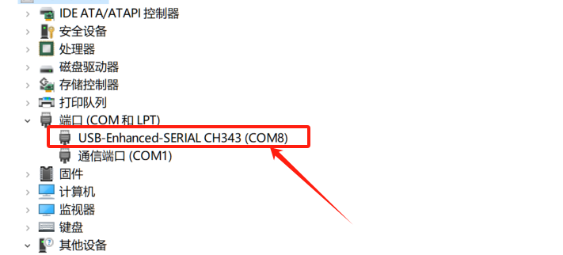

# 采集启动与故障日志

日志可以区分启动失败、网络连接、激活和音频问题。先采集，再改变条件；只截最后一行通常会漏掉真正原因。

## 准备工作 {#scope}

准备数据线和适合系统的串口工具，确认是原生 USB 还是 USB-UART 桥接器。驱动只从板卡或芯片厂商获取，不把某款工具附带的历史安装包当作所有设备必装项。

## 1. 找到端口 {#port}

先查看端口列表，插入设备后再比较新出现的端口。Windows 可用设备管理器；macOS/Linux 查看工具的串口选择列表。按板上 USB/UART 丝印和厂商说明识别，不按“左口/右口”推定。

端口可能在 ROM 下载模式与应用运行时变化。日志要看正常启动时的端口；有端口不等于固件已经在运行。

<figure class="source-figure">

[](../../public/images/zh/doc-23-image-001.webp)

<figcaption>Windows 设备管理器中查找串口的示例；COM 编号因电脑而异。</figcaption>
</figure>

## 2. 连接并重新启动 {#capture}

1. 关闭占用同一端口的烧录页、IDE 监视器和其他终端。
2. 选择端口。基础板通常使用 **115200、8 数据位、无校验、1 停止位**，其他板型以配置为准。
3. 打开串口后短按 RESET/EN，采集从启动开始的信息。
4. 复现一次问题，保留操作前、发生时和恢复后的相关片段。
5. 导出纯文本，附上硬件、固件版本和实际步骤。

已安装 ESP-IDF 时可直接使用：

```sh
idf.py -p COM5 monitor
```

把 `COM5` 换为自己的端口；使用 Ctrl+] 退出。未安装 SDK 的用户不必为采日志安装整个环境，可使用 Python 的 [pySerial miniterm](https://pyserial.readthedocs.io/en/latest/tools.html#module-serial.tools.miniterm)。在独立 Python 环境安装 `pyserial` 后，执行 `python -m serial.tools.miniterm COM5 115200`，替换实际端口；用 Ctrl+] 退出。

## 3. 先看什么 {#read}

| 日志阶段 | 关注内容 |
| --- | --- |
| 启动 | 芯片、版本、板型、Flash/PSRAM、分区和第一条初始化错误 |
| 联网 | 扫描、连接、断开、是否反复回到配网 |
| 激活/OTA | HTTP 状态、激活状态，不公开完整凭据 |
| 对话 | 连接、录音、播放、工具调用、异常重启位置 |

看不懂的错误保留原文。不要只提取大量后续错误而删除第一条失败信息。

## 怎么确认完成 {#verify}

文本包含启动版本和可复现故障的上下文，别人能按操作顺序定位。分享前遮盖 Wi-Fi 密码、端点令牌、手机号和不必要的设备标识；截图不能代替可复制的错误文本。

## 工具与下一步 {#materials}

串口工具请从维护者的官方发行入口下载。固件包写入请回到[烧录指南](../firmware/flashing)，不要在串口窗口里输入随机控制命令。
