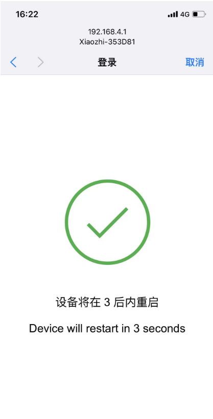
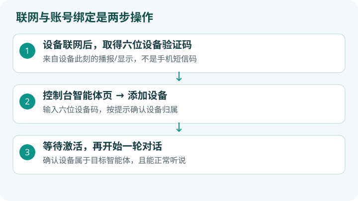

# 配网与绑定设备

先让设备联网，再把设备验证码填进自己的小智控制台。完成后，就可以开始第一轮对话。

## 准备工作 {#scope}

- 已烧录匹配固件、供电稳定的设备；不确定时先看[烧录教程](../firmware/flashing.md)。
- 可用网络。本篇基础 ESP32-S3 Wi-Fi 方案使用 2.4GHz Wi-Fi 或手机热点，不采用需要网页二次登录的校园/访客网络。
- 能打开[小智控制台](https://xiaozhi.me/console/)的手机或电脑。

先确认固件选择的是**热点配网**还是 **BluFi**。它们是两条不同路径，不是安装完成后一定能随时切换的两个按钮。4G 或 SF32 蓝牙 PAN 设备请按对应板卡说明联网。

## 1. 让设备进入配网模式 {#enter-mode}

从未保存过 Wi-Fi 的设备启动后通常会自动进入配网。优先看屏幕和语音提示，不用某种 LED 颜色判断所有设备的状态。

对于本文[基础 S3 板型](../hardware/breadboard-esp32-s3.md)，已配置设备可在重启后的启动阶段**短按 BOOT**请求重新配网；进入后松开按键。其他板型的操作可能是长按、双击或菜单，应查其说明。

这里不需要按住 BOOT 再按 RESET；后者会进入烧录用的 ROM 下载模式。

## 2A. 使用热点配网 {#hotspot}

1. 找到设备提示的 Wi-Fi 热点并连接。热点通常带有 Xiaozhi 前缀，准确名称以设备显示或播报为准。
2. 手机提示“无互联网”时，选择保留连接，不要立即切回其他 Wi-Fi。
3. 自动弹出的配网页面中选择目标路由器/手机热点，填写密码并保存。
4. 没有自动弹页时，在浏览器地址栏打开设备提示的网址；本版本热点默认地址为 `http://192.168.4.1`。这是设备本地页面，不是小智官网。
5. 等待设备连接目标网络。手机随后切回能上网的网络，再打开控制台。

手机自动切网、VPN 或代理可能影响访问设备本地地址。先确认仍连接着设备热点，再检查这些设置；无需把本地热点强制改成 HTTPS。

<figure class="source-figure">

<figcaption>热点页面提示保存成功后，等待设备重启并连接目标网络；这一步还没有完成账号绑定。</figcaption>
</figure>

## 2B. 使用 BluFi 配网 {#blufi}

仅当固件启用了 BluFi 且板型支持时使用：

1. 安装来自乐鑫官方渠道的 EspBlufi 客户端，打开手机蓝牙，并按系统要求授予扫描/连接权限。
2. 在客户端扫描设备，选择与自己板卡对应的广播名称。
3. 按客户端引导选择目标 Wi-Fi、输入密码并提交，观察连接结果。
4. 设备联网后，回到能访问互联网的网络继续绑定。

不要只在手机系统蓝牙列表配对后就认为完成了 Wi-Fi 配网。广播名称与客户端界面可能随固件/SDK 改变，细节见[固件 BluFi 指南](https://github.com/78/xiaozhi-esp32/blob/v2.6.0/docs/blufi_zh.md)。

## 3. 输入六位设备验证码 {#bind}

1. 等待设备获取联网配置，并显示或播报 **六位设备验证码**。没有出现时，按该设备的对话键触发一次交互，继续观察屏幕/日志。
2. 打开[控制台](https://xiaozhi.me/console/)并登录。按页面提供的方式使用手机号或 Google；未注册的国际手机号应按页面提示使用 Google，而不是反复等短信。
3. 在智能体页面点击 **添加设备**，输入设备此刻显示的六位验证码并提交。
4. 若要把设备加入已有智能体，在该智能体的设备管理中按页面提示操作；不同设备类型可能有限制，以弹窗提示为准。
5. 绑定成功后等待设备完成激活。必要时短按对话键或重启，开始对话。

设备验证码不是短信验证码，也不是 MAC 地址或产品序列号。不要把它发到公开讨论中让他人代绑。

<figure class="source-figure">

<figcaption>联网与账号绑定是两步操作。点击查看大图。</figcaption>
</figure>

## 怎么确认完成 {#verify}

::: tip 完成标志
控制台中能看到自己的设备，设备不再重复要求填写验证码；按键或已配置的唤醒词可以开始一轮对话，并能听到回答。
:::

## 常见问题 {#troubleshooting}

| 现象 | 排查顺序 |
| --- | --- |
| 找不到设备热点 | 核对是否刷了 BluFi/4G 版、是否进入配网、供电和启动日志；不要缠绕或触摸天线试修 |
| 打不开 192.168.4.1 | 确认手机仍连设备热点，地址不是搜索词，检查自动切网/VPN |
| 找不到家中 Wi-Fi | 基础 S3 方案先用 2.4GHz、可直接输入密码的网络测试 |
| Wi-Fi 已连接却没有设备码 | 检查网络是否能访问互联网、时间/OTA 请求是否成功，保存相关日志 |
| 设备码无效或过期 | 使用设备新显示的码；不重复提交旧照片里的码 |
| 设备已属于其他账号 | 联系原持有人按控制台流程解绑；刷固件不能替代服务端归属处理 |

## 下一步 {#next}

在控制台选择智能体的语言、角色和音色。需要工具能力时继续[MCP 快速开始](../mcp/quickstart.md)；遇到异常查看[常见问题](../faq/index.md)。

固件配网行为参照 [v2.6.0 Wi-Fi 实现](https://github.com/78/xiaozhi-esp32/blob/v2.6.0/main/boards/common/wifi_board.cc)。
