# S3 面包板的 4G 扩展：ML307R 与 NT26K

先完成[基础 S3](./breadboard-esp32-s3)的音频、显示和按键，再扩展蜂窝网络。ML307R 与 NT26K 是两条不同的板级适配路径，不是更换名称后继续烧 Wi-Fi 基础固件。

## 开始前：模块、SIM 卡与电源 {#scope}

核对核心板完整型号、固件/AT 版本、天线、SIM 卡与数据网络服务；“同一通信芯片”不保证核心板引出的电源输入、使能及串口电平相同。先确认该块核心板的官方电气资料和启动步骤，再接电。

::: warning 先确认模块的供电方案
下面的位置图用于找排针和布置模块；其中的 **ML307R 的 LDO 裸焊点取电**、**NT26K 从开发板 3V3 取电**都不作为本版通用接法。模块电源需按实际核心板输入范围、峰值电流与启动要求设计；独立供电时与 ESP32 共地，不把电池/外部电源同时灌入不明电源节点。
:::

位置图中的 MAX98357A VIN 使用 3V3 支路；采用基础 S3 的 USB 5V 功放方案时，音频电源要保持整套方案一致。SD/GAIN 的短接由实际功放模块工作设置决定。

## 当前固件的信号连接 {#signals}

<figure class="source-figure wiring-figure">

[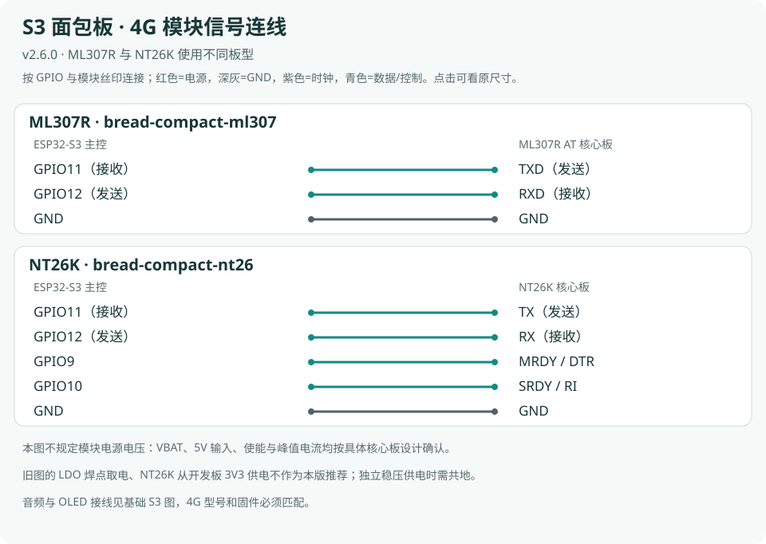](../../public/images/zh/breadboard-4g-signals-v2.6.0.svg)

<figcaption>ML307R / NT26K 当前串口、握手与共地关系。固件 v2.6.0 的信号连线示意，不表示开发板物理排针位置。</figcaption>
</figure>

GPIO11 是 ESP32 接收端，接模块 TX；GPIO12 是 ESP32 发送端，接模块 RX。NT26K 另用 GPIO9 对应 MRDY/DTR、GPIO10 对应 SRDY/RI。音频 GPIO4/5/6 与 GPIO7/15/16、OLED GPIO41/42 沿用基础 S3 的信号关系。

## ML307R：两种主板的位置图 {#ml307}

ML307R 有不同供应商的核心板。下图用于识别型号与接口；购买时核对当前电气资料、天线、SIM 卡和 AT 固件，不按图片中的价格或套餐下单。

<figure class="source-figure">

[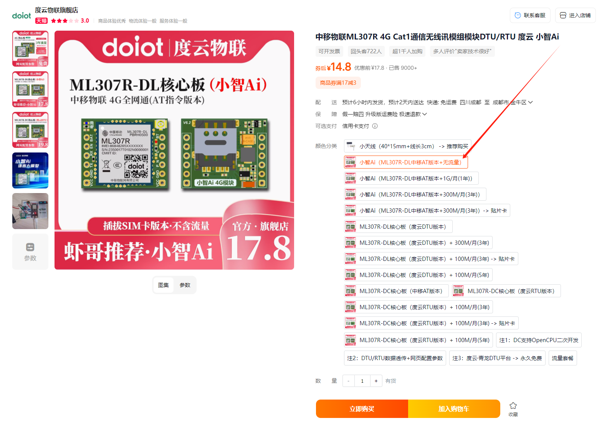](../../public/images/zh/doc-05-image-017.webp)

<figcaption>一种 ML307R 核心板与商品界面。点击查看大图。</figcaption>
</figure>

<figure class="source-figure">

[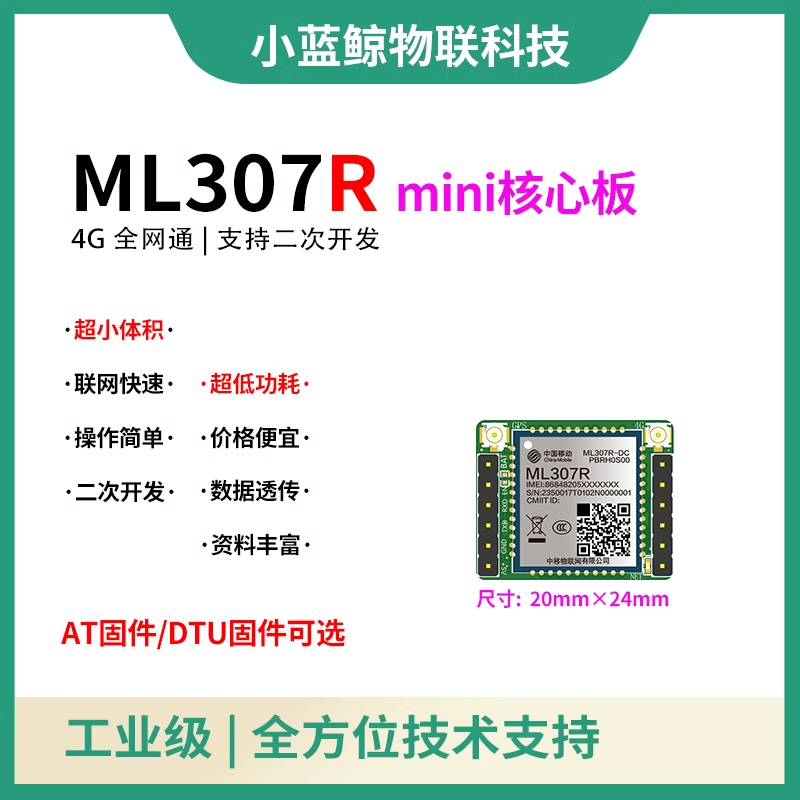](../../public/images/zh/doc-05-image-018.webp)

<figcaption>另一种 ML307R mini 核心板。点击查看大图。</figcaption>
</figure>

### 乐鑫标准版 · 44 针 {#ml307-44}

<figure class="source-figure wiring-figure">

[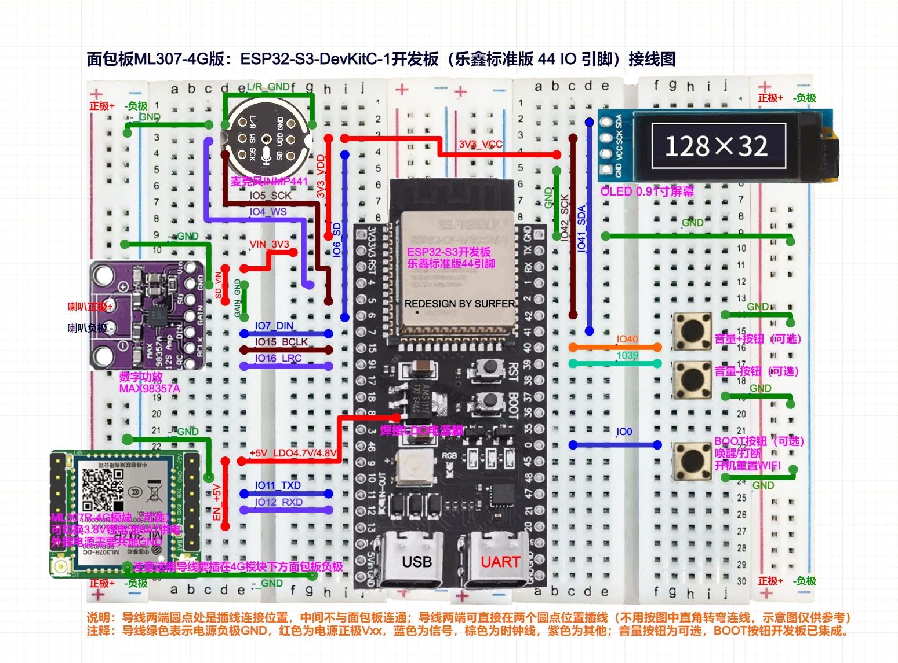](../../public/images/zh/doc-05-image-021.jpg)

<figcaption>ML307R + 44 针主板接线图；信号参考有效，旧 LDO 电源分支不直接沿用。点击查看大图。</figcaption>
</figure>

### GOOUUU 果云版 · 42 针 {#ml307-42}

<figure class="source-figure wiring-figure">

[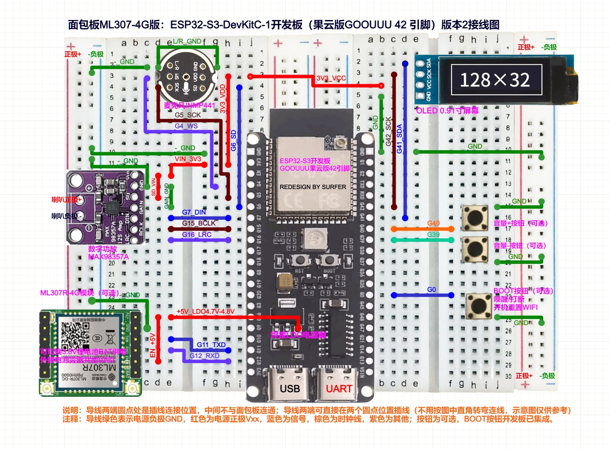](../../public/images/zh/doc-05-image-026.jpg)

<figcaption>ML307R + 42 针主板接线图；位置不同，UART 仍是 GPIO11/12。点击查看大图。</figcaption>
</figure>

### 实物效果与隐藏连线 {#ml307-results}

<figure class="source-figure">

[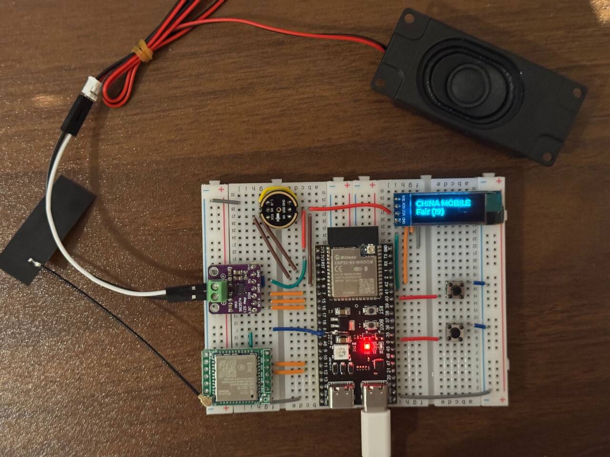](../../public/images/zh/doc-05-image-038.jpg)

<figcaption>ML307R 扩展完成效果。点击查看大图。</figcaption>
</figure>

<figure class="source-figure">

[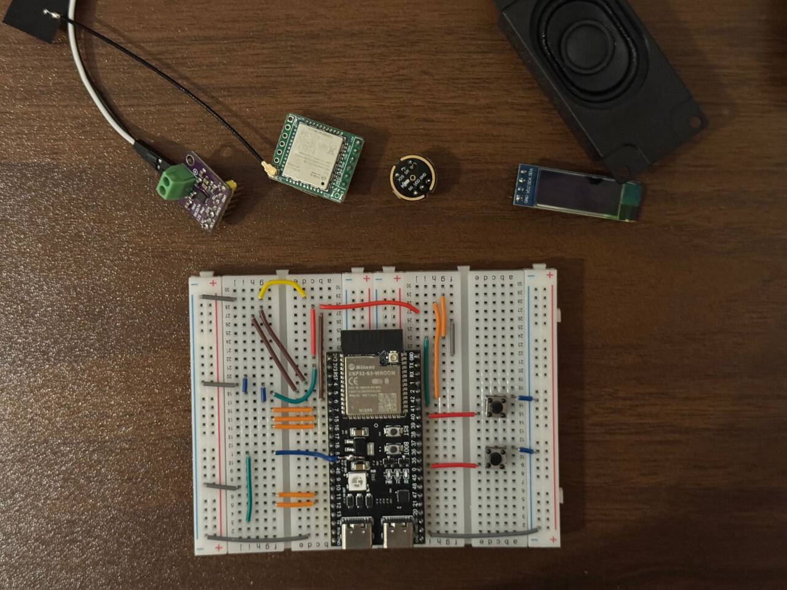](../../public/images/zh/doc-05-image-039.jpg)

<figcaption>ML307R 方案移开外围模块后的连线视角。点击查看大图。</figcaption>
</figure>

LDO 取电部位的辨认（不作为本页接电步骤）

<figure class="source-figure">

[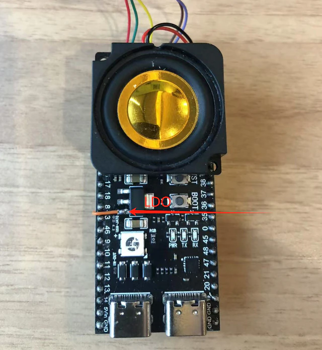](../../public/images/zh/doc-05-image-025.webp)

<figcaption>LDO 取电局部：本页不从该焊点引电。点击查看大图。</figcaption>
</figure>

## NT26K：两种主板的位置图 {#nt26}

<figure class="source-figure">

[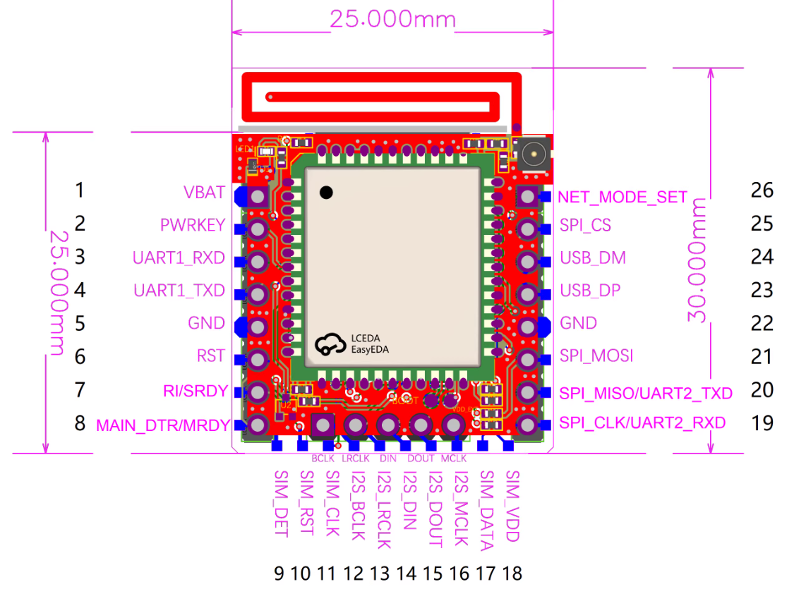](../../public/images/zh/doc-05-image-019.webp)

<figcaption>NT26K 核心板的引脚分布示意；按实际板修订核对信号与电源接口。点击查看大图。</figcaption>
</figure>

### 乐鑫标准版 · 44 针 {#nt26-44}

<figure class="source-figure wiring-figure">

[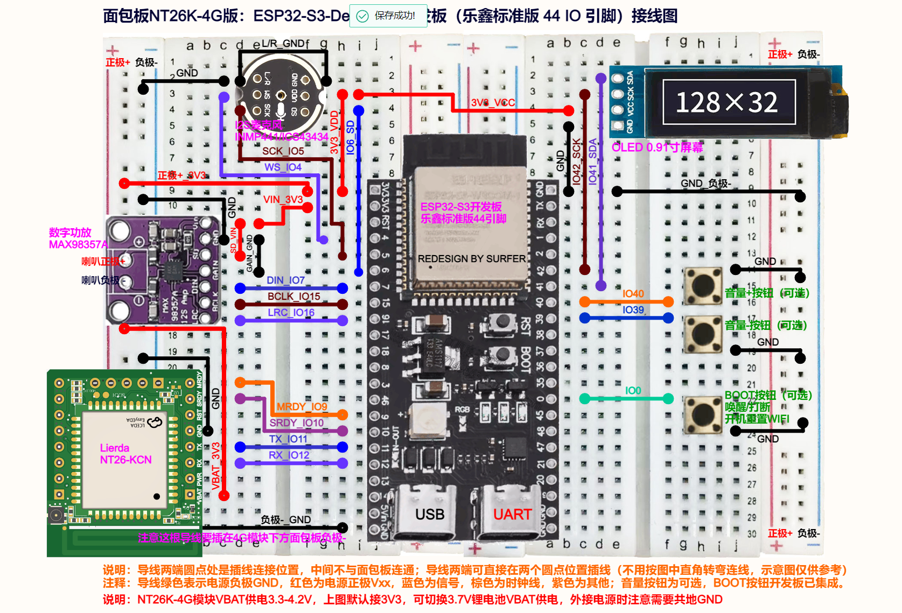](../../public/images/zh/doc-05-image-031.webp)

<figcaption>NT26K + 44 针主板接线图；GPIO9/10/11/12 与当前配置核对，图中 3V3 供电需另行复核。点击查看大图。</figcaption>
</figure>

<figure class="source-figure">

[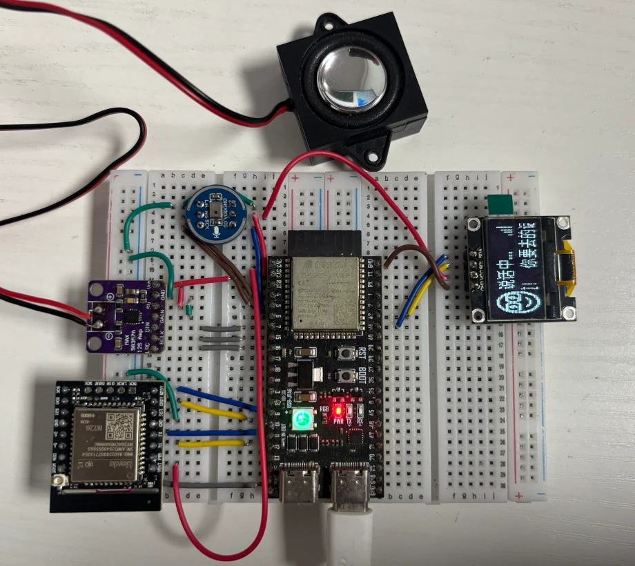](../../public/images/zh/doc-05-image-032.webp)

<figcaption>NT26K 标准板样机装配实物。点击查看大图。</figcaption>
</figure>

### GOOUUU 果云版 · 42 针 {#nt26-42}

<figure class="source-figure wiring-figure">

[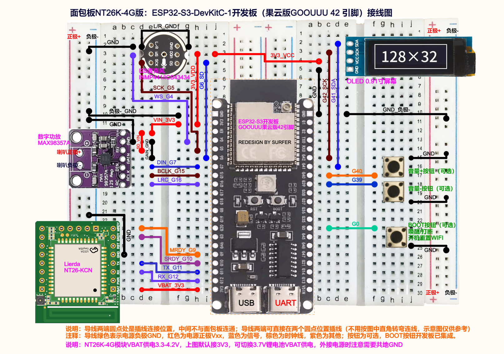](../../public/images/zh/doc-05-image-033.webp)

<figcaption>NT26K + 42 针主板接线图；不能把 ML307R 的两根串口线当作完整 NT26K 接法。点击查看大图。</figcaption>
</figure>

<figure class="source-figure">

[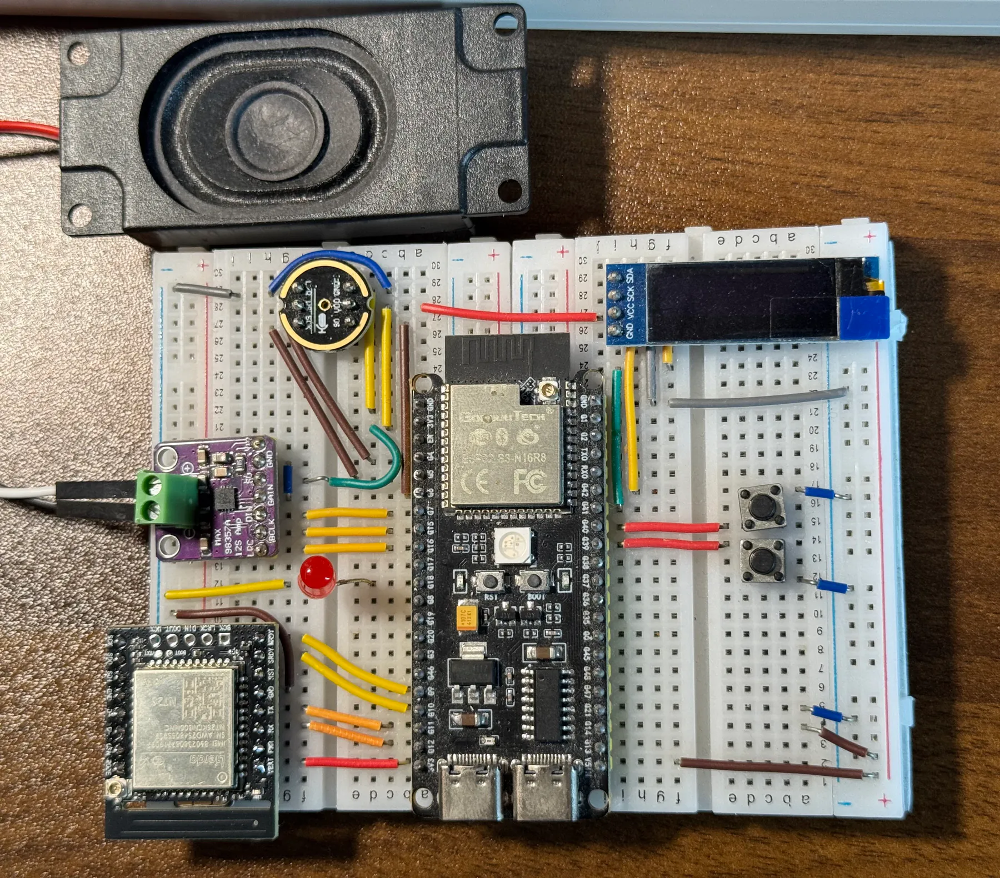](../../public/images/zh/doc-05-image-034.webp)

<figcaption>NT26K 果云板样机装配实物。点击查看大图。</figcaption>
</figure>

## 选择固件并分段验证 {#build}

| 模块 | 固件板型 | v2.6.0 构建选项 |
| --- | --- | --- |
| ML307R | `bread-compact-ml307` | 128×32；另有 `bread-compact-ml307-128x64` |
| NT26K | `bread-compact-nt26` | 默认 SSD1306 128×32 |

以[ML307 配置](https://github.com/78/xiaozhi-esp32/blob/4de00aed740595a8713b01f8332b9b2cf30685bc/main/boards/bread-compact-ml307/config.h)、[ML307 构建变体](https://github.com/78/xiaozhi-esp32/blob/4de00aed740595a8713b01f8332b9b2cf30685bc/main/boards/bread-compact-ml307/config.json)、[NT26 配置](https://github.com/78/xiaozhi-esp32/blob/4de00aed740595a8713b01f8332b9b2cf30685bc/main/boards/bread-compact-nt26/config.h)及[NT26 构建变体](https://github.com/78/xiaozhi-esp32/blob/4de00aed740595a8713b01f8332b9b2cf30685bc/main/boards/bread-compact-nt26/config.json)为准。

1. 断电核对串口方向、NT26K 握手线、公共 GND 及已确认的电源路径。
2. 使用该模块对应的板型构建，按[烧录指南](../firmware/flashing)安装；不是给 Wi-Fi 基础固件随意增加四根线。
3. 查看[串口日志](../faq/serial-logs)，区分模块未响应、SIM 卡/注册、数据网络、OTA/对话连接这几层问题。
4. 确认数据网络可用后，再完成[设备绑定](../getting-started/wifi-and-binding#bind)，测试提示音、录音与一轮对话。
5. 测试网络重连和播放时的供电稳定性；有复位或射频干扰时保留版本与现象，按模块设计调整天线与音频部分的间距和布线，不把天线粘在扬声器线上。

## 完成标志与下一步 {#verify}

模块、网络注册与数据通路均有日志证据，设备绑定并能对话，播放和网络发送不会导致复位。示例样机照片不等于这套电源设计已对所有核心板、SIM 卡或网络完成验证。

返回[基础 S3 的变体目录](./breadboard-esp32-s3#variants)，屏幕扩展另见[彩屏](./displays/st7789)。
