# C3 面包板：ES8311 音频方案

 C3-N16-SF 搭配 ES8311/NS4150 音频模块，参考 Xmini-C3。它不是任意 C3 加 INMP441/MAX98357A 的通用接线。

## 准备工作 {#scope}

确认目标芯片、Flash 容量、Codec 模块原理图、PA 使能和显示屏。ES8311 模块的模拟麦克风/功放外围必须完整；模块标的 DI/DO 要核对相对于谁的方向。

## 先认齐这套 C3 的配件 {#parts}

<figure class="source-figure">

[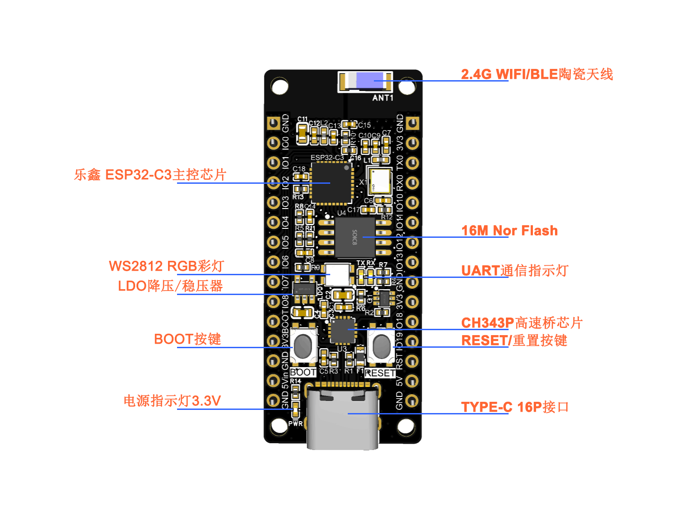](../../public/images/zh/doc-12-image-001.webp)

<figcaption>C3 主控模块。</figcaption>
</figure>
<figure class="source-figure">

[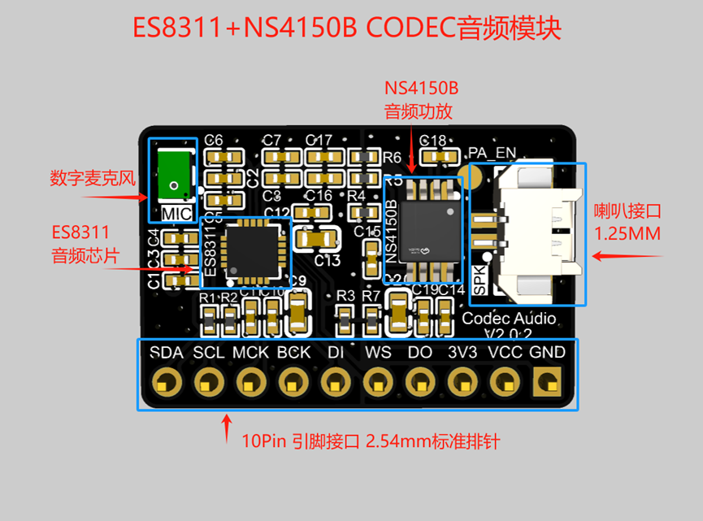](../../public/images/zh/doc-12-image-002.webp)

<figcaption>ES8311 与 NS4150 音频模块；核对具体版本和丝印。</figcaption>
</figure>
<figure class="source-figure">

[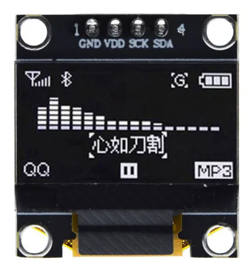](../../public/images/zh/doc-12-image-009.webp)

<figcaption>OLED 模块。</figcaption>
</figure>

本方案的语音部分是 ES8311 + NS4150B 模块，不能把 S3 的独立 INMP441/MAX98357A 接法套过来。板卡、Codec 与 OLED 的照片在上方；其余配件如下。

<figure class="source-figure">

[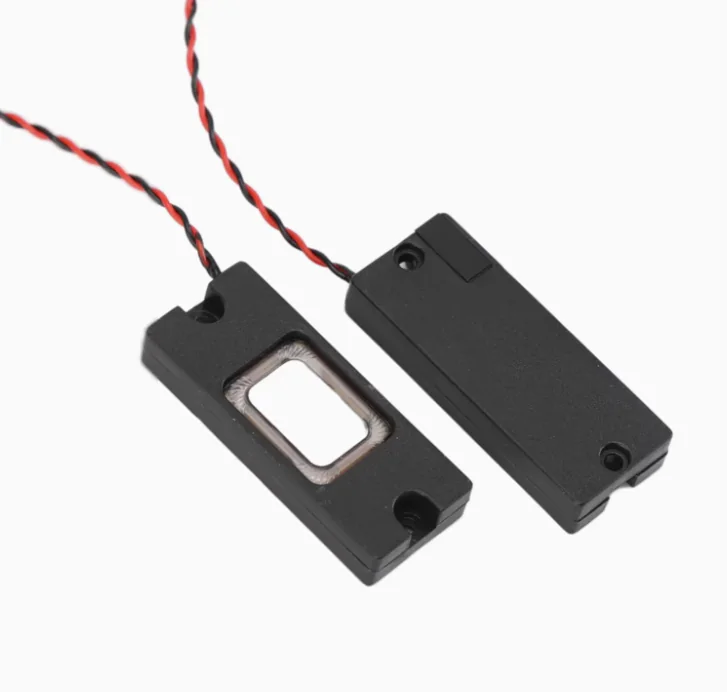](../../public/images/zh/doc-12-image-003.webp)

<figcaption>C3 方案的腔体扬声器。点击查看大图。</figcaption>
</figure>

<figure class="source-figure">

[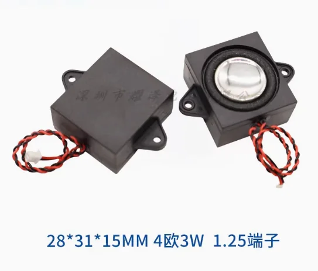](../../public/images/zh/doc-05-image-010.webp)

<figcaption>另一种扬声器，阻抗和接头需匹配功放。点击查看大图。</figcaption>
</figure>

<figure class="source-figure">

[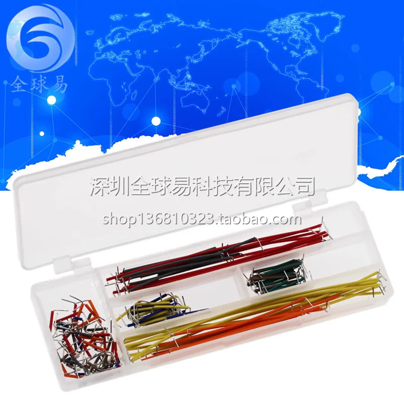](../../public/images/zh/doc-05-image-011.webp)

<figcaption>C3 面包板用短跳线。点击查看大图。</figcaption>
</figure>

<figure class="source-figure">

[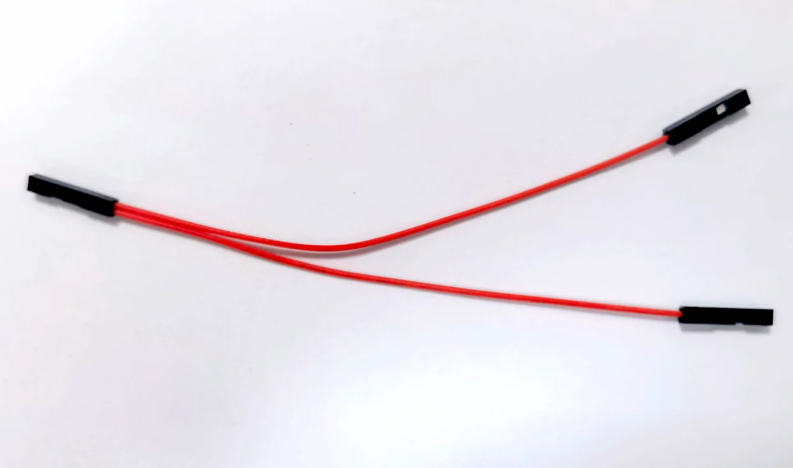](../../public/images/zh/doc-05-image-012.webp)

<figcaption>C3 模块间的杜邦连接线。点击查看大图。</figcaption>
</figure>

<figure class="source-figure">

[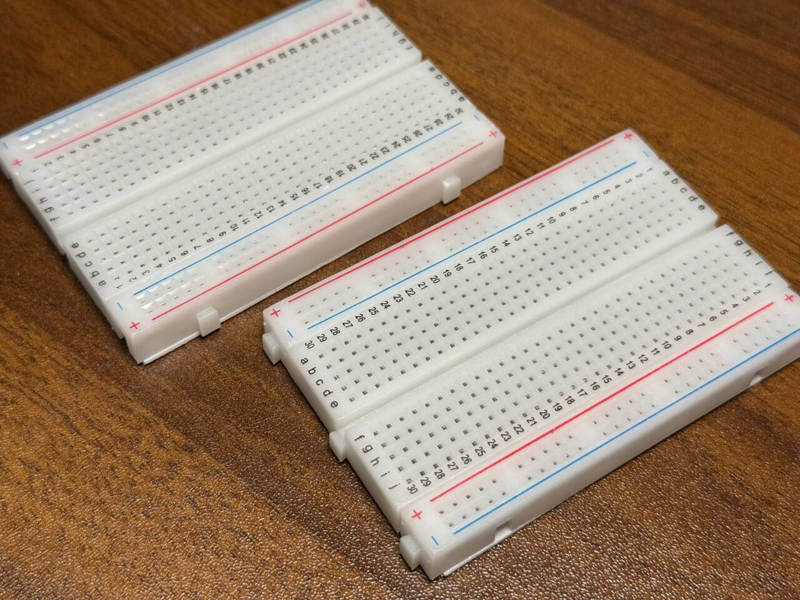](../../public/images/zh/doc-05-image-013.jpg)

<figcaption>C3 使用的可拼面包板。点击查看大图。</figcaption>
</figure>

<figure class="source-figure">

[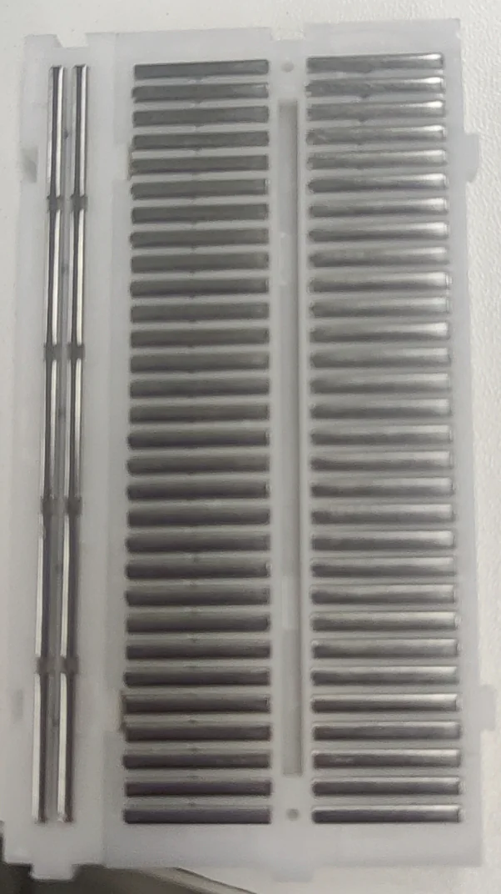](../../public/images/zh/doc-05-image-014.webp)

<figcaption>面包板内部连通结构。点击查看大图。</figcaption>
</figure>

<figure class="source-figure">

[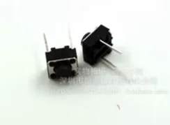](../../public/images/zh/doc-05-image-020.webp)

<figcaption>可选轻触按钮；确认同侧内部连通关系。点击查看大图。</figcaption>
</figure>

## 1. 对照固件引脚 {#wiring}

v2.6.0 的 `xmini/c3` 使用下列配置；新硬件必须确认与其真正相同，否则建立[独立板型](../development/custom-board.md)。

| 功能 | GPIO |
| --- | --- |
| ES8311 I2C SDA / SCL | 3 / 4 |
| I2S MCLK / BCLK / WS | 10 / 8 / 6 |
| Codec ADC 数据进入主控 DIN | 7 |
| 主控 DOUT 输出到 Codec DAC | 5 |
| PA 使能 | 11 |
| BOOT | 9 |

显示屏与 Codec 可能共用 I2C，总线、电压和设备地址要分别确认。用短线和可靠公共 GND；不因 GPIO 名称相同就忽略模块供电条件。

### 总接线图与模块方向 {#wiring-diagram}

<figure class="source-figure wiring-figure">

[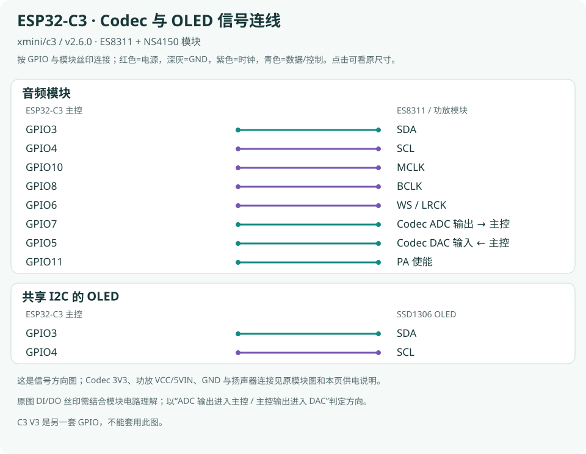](../../public/images/zh/breadboard-c3-signals-v2.6.0.svg)

<figcaption>C3 当前 Codec、功放使能与 OLED 信号关系。固件 v2.6.0 的信号连线示意，不表示开发板物理排针位置。</figcaption>
</figure>

原面包板总图保留如下。**图中音频模块同时标有 3V3 与 VCC/5VIN，不是一个电源脚的两个名字**：按具体模块原理图区分 Codec 电源和功放电源，不能短接或互换。原 DI/DO 标签按该模块对主控的约定理解，以“Codec ADC 输出进入 ESP32 GPIO7、ESP32 GPIO5 输出进入 Codec DAC”核对方向。

<figure class="source-figure wiring-figure">

[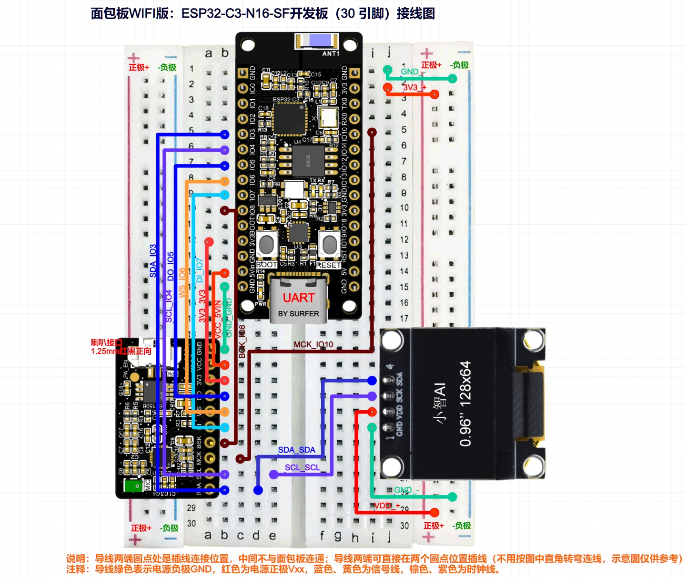](../../public/images/zh/doc-12-image-011.webp)

<figcaption>C3-N16-SF 与 ES8311/NS4150B、OLED 的完整位置图；模块信号方向和双电源脚见图前说明。点击查看大图。</figcaption>
</figure>

## 2. 安装并使用 {#build}

1. 如果完全复现已有硬件，选择对应 `xmini/c3` 构建；V3 与 4G 不是同一配置。
2. 在[在线编译](../firmware/online-builder.md)或[官方发布](../firmware/downloads.md)取得匹配版本，按[烧录流程](../firmware/flashing.md)安装。
3. 先验证提示音、显示和按键，再[联网绑定](../getting-started/wifi-and-binding.md)。
4. 测试录音/播放后，再启用该芯片兼容的唤醒模型。

C3 可使用兼容的轻量 WakeNet 路径，项目也有 C3 4G 板型。无 PSRAM 和不同资源条件仍影响模型，见[唤醒词](../development/wake-words.md)。

## 实物与屏幕变体 {#assembly-results}

### OLED 基础方案 {#oled-result}

<figure class="source-figure">

[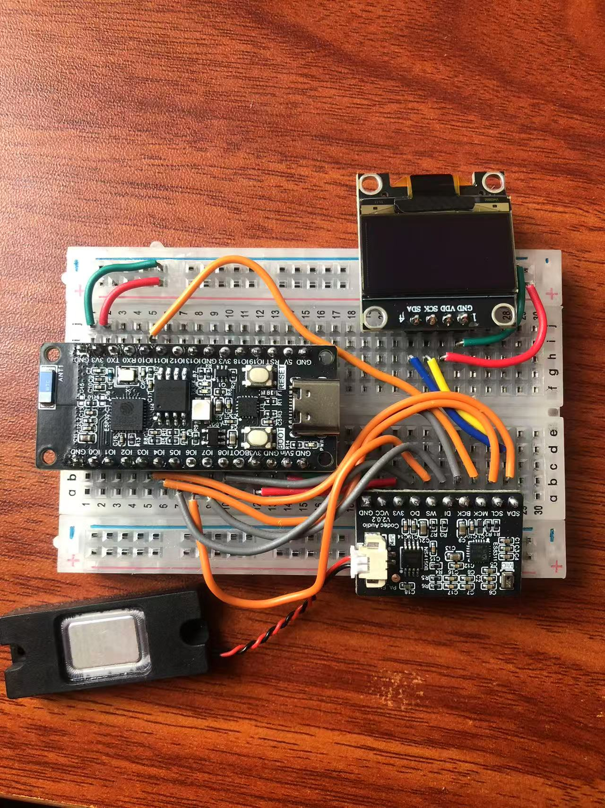](../../public/images/zh/doc-12-image-012.jpg)

<figcaption>C3 + OLED 完成实物。点击查看大图。</figcaption>
</figure>

<figure class="source-figure">

[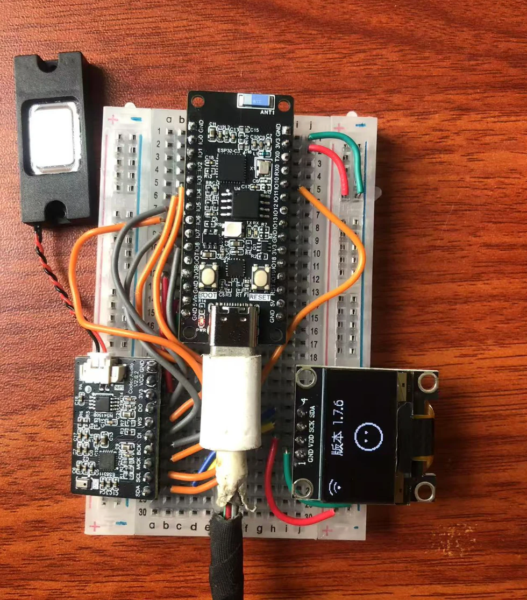](../../public/images/zh/doc-12-image-013.webp)

<figcaption>C3 + OLED 的另一侧连线。点击查看大图。</figcaption>
</figure>

当前本文采用的 `xmini/c3` 是 I2C OLED 路径，构建也不支持 SPI 彩屏；需要恢复彩屏方案时，先确认屏幕驱动、SPI GPIO、板级代码与独立构建身份，可参考Surfer-C3-1.14TFT 开发板。

### ES8311 初始化报错时

日志出现 `Fail to write to dev 30`、`I2C read/write error` 或 `ES8311 ... Open fail` 时，先保留第一条错误，再按顺序排查：

1. 断电，逐根核对 SDA/SCL、Codec 电源、公共 GND 和接触是否牢固；确认没有把 Codec 的控制总线与 I2S 音频线混接。
2. 把面包板的 I2C 跳线缩短，并让 Codec 靠近主控，移开干扰源；不要带电掰动或插拔模块。
3. 若 OLED 共用这组总线，断电后暂时移除 OLED，再启动判断问题是否来自另一外设或接线。
4. 仍失败时，在自己的板级调试环境扫描 I2C，核对实际地址、上拉和对应驱动。不要只凭十进制日志中的 `30` 猜另一个十六进制地址，也不要直接套用 V3 的 GPIO0/1。

每改一个条件就重新采集启动日志。旧依赖的临时菜单修复不适用于所有新版本；接口与 Codec 适配以本文固定固件版本为准。

## 怎么确认完成 {#verify}

指定的 Codec 和 PA 能录放，显示正常、按键发起一轮对话成功；没有 I2C 失败、持续爆音或复位。出现 I2C 问题先检查 SDA/SCL、上拉、电源与地址，不直接判定固件损坏。

## 历史附件与下一步 {#materials}

安装固件时选择匹配的正式构建，不使用用途不明的调试 `.bin`。板级配置以[固件 xmini/c3](https://github.com/78/xiaozhi-esp32/tree/4de00aed740595a8713b01f8332b9b2cf30685bc/main/boards/xmini/c3)为准；成品板阅读[Xmini 系列](./boards/xmini-c3.md)。
