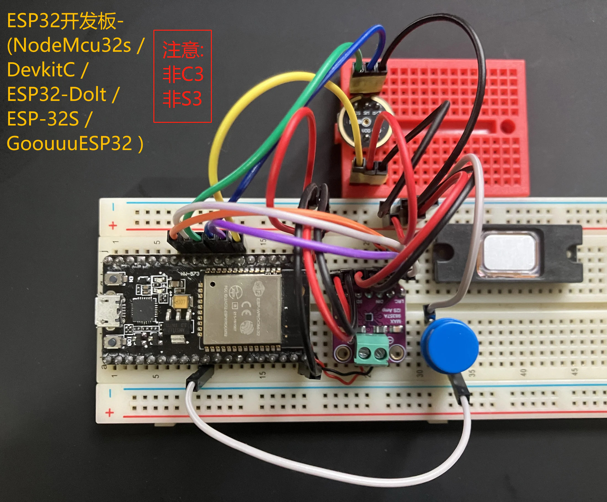
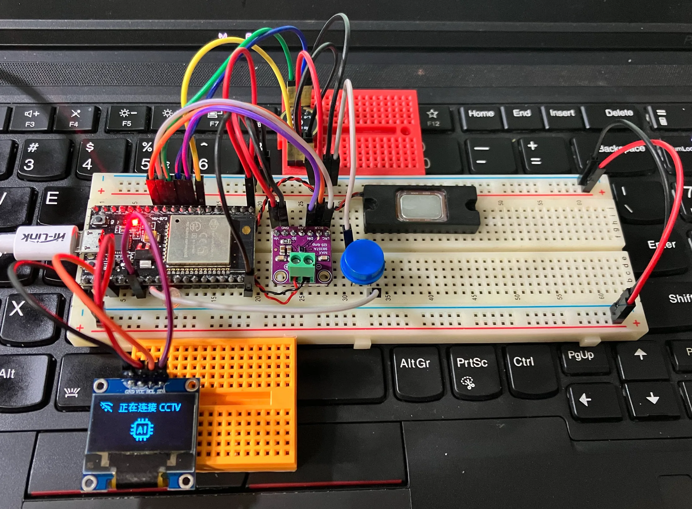
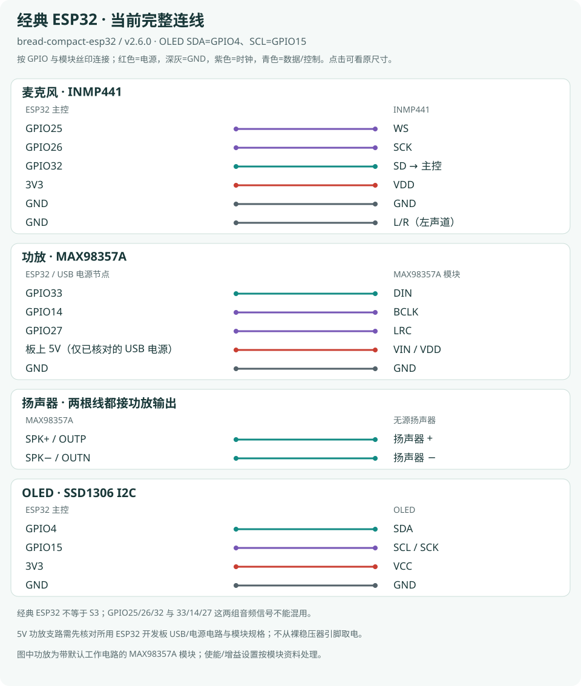
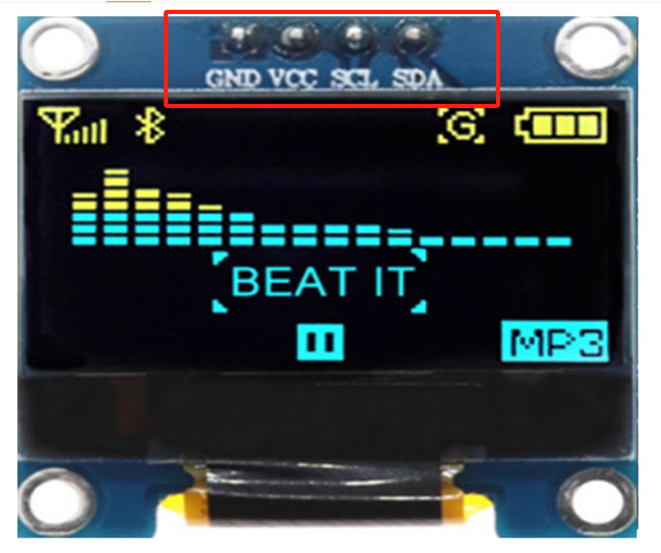

# 经典 ESP32 面包板

本页是经典 ESP32 的方案，不是 ESP32-S3 或 C3。 4MB、无 PSRAM 设备仍有用途，但不能承诺获得需要 PSRAM 或更高资源的全部功能。

## 先看装配效果 {#finished-overview}

<figure class="source-figure">

<figcaption>经典 ESP32 样机。</figcaption>
</figure>
<figure class="source-figure">

<figcaption>经典 ESP32 装配参考。</figcaption>
</figure>

## 1. 确认目标 {#scope}

当前对应目录是 `bread-compact-esp32`。核对 ESP32 模组、实际 Flash、麦克风、功放和显示驱动，选择正确的 128×64/128×32 变体。

## 2. 以现行代码核对接线 {#wiring}

<figure class="source-figure wiring-figure">

<figcaption>经典 ESP32：当前音频与 OLED 的逐根连线。固件 v2.6.0 的信号连线示意，不表示开发板物理排针位置。</figcaption>
</figure>

### 逐根核对

| 功能 | 当前默认 GPIO |
| --- | --- |
| 麦克风 WS / SCK / 数据输入 | 25 / 26 / 32 |
| 功放数据 / BCLK / LRCK | 33 / 14 / 27 |
| OLED SDA / SCL | **4 / 15** |
| BOOT / 外接 ASR 输入 | 0 / 19 |

OLED 的 GPIO 按[当前 config.h](https://github.com/78/xiaozhi-esp32/blob/4de00aed740595a8713b01f8332b9b2cf30685bc/main/boards/bread-compact-esp32/config.h)核对。电源、L/R、功放负载按具体模块资料确认。

<figure class="source-figure">

<figcaption>OLED 的引脚丝印；GPIO 连接使用下文固件表。</figcaption>
</figure>

## 3. 安装与分阶段测试 {#build}

1. 优先使用[在线编译与烧录](../firmware/online-builder.md)，选择准确板型及内存布局。
2. 按[烧录指南](../firmware/flashing.md)安装，先检查启动、显示与提示音。
3. 完成[配网绑定](../getting-started/wifi-and-binding.md)，先用按键测试对话。
4. 只有满足资源和模型条件时再启用唤醒；无 PSRAM 的板不能直接套用有 PSRAM 的配置。

需要外接语音模块时按[外接 ASR](./external-wake-module.md)单独确认电平与触发，4G/自定义 PCB 也需要独立板型，不让群文件代替可追溯的发布来源。

## 怎么确认完成 {#verify}

固件报告正确芯片/内存和变体，显示、音频、网络及按键对话正常。分别记录启用和不支持的功能；不要把“能跑”解释成与 S3/P4 的功能完全相同。

## 下一步 {#sources}

保留原型实物图帮助识别，旧采购截图、群宣传及旧接线表不再用于当前操作。更换引脚或器件时继续[自定义板型](../development/custom-board.md)。
