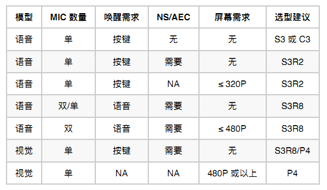

# 小智设备的硬件设计要点

硬件设计需要同时考虑芯片资源、供电、音频和结构。先定义要实现的功能，再用器件资料和测试结果核对方案。

## 1. 从信号与负载选型 {#scope}

先确定语音、显示、摄像头、网络、低功耗和升级需求，再选择芯片、Flash/PSRAM、Codec 和外设。模型、AFE 与唤醒能力要与[现行固件支持](./supported-boards.md)交叉核对。

<figure class="source-figure">

<figcaption>芯片与语音能力的选型示意表：麦克风数量、唤醒、音频处理和显示需求需一起考虑。具体支持范围按所用固件核对。</figcaption>
</figure>

## 2. 供电与噪声 {#power}

评估 Wi-Fi/蜂窝发射、播放和背光的峰值负载，而不是只看待机电流。检查稳压余量、回流路径、去耦、接插件和电源切换。音频噪声需要区分电源纹波、数字耦合、接地和结构问题。

电池保护、充电、升压和边充边用是不同功能，按[电池供电](./battery-power.md)确定电源路径，不能仅凭一个 USB 口推断都有。

## 3. 拾音与播放 {#acoustics}

记录麦克风的灵敏度、信噪比、供电和接口条件，核对拾音孔、声腔和方向。扬声器参数与腔体一起设计，避免声压直接耦合进麦克风或壳体振动造成反馈。

[AEC](../development/audio-and-aec.md)需要真实的参考信号和合适隔离；增加麦克风数量或勾选软件选项不能保证效果。耳机/线路输出与扬声器功放分开设计，见[音频输出](./audio-output.md)。

### 双麦与腔体的量化参考

下面是[AI 类产品声学设计参考](https://icnynnzcwou8.feishu.cn/docx/KCotdF4KgocDm0xqXcycBtGLnWe)给出的工程起点，面向双麦阵列、回声参考与整机声学设计；不是对所有面包板的功能保证。选型时同时核对器件数据手册、测试条件和自己的产品指标。

| 项目 | 参考条件 |
| --- | --- |
| 双麦信噪比 | 不低于 62dB，优先大于 64dB |
| 麦克风灵敏度一致性 | 公差控制在 ±2dB，阵列优先 ±1dB |
| 麦克风间距 | 4–6.5cm，结构与拾音通路尽量一致 |
| 频率响应 | 50Hz–16kHz 范围内波动在 ±3dB 以内 |
| MEMS 麦克风电源抑制比 | PSRR 大于 55dB |
| 拾音孔 | 孔径/宽度建议大于 1mm，通路尽量短；深度与直径比小于 4:1 |
| 回声参考电压 | 不超过 ADC 允许输入范围；播放最大计划音量时不得饱和或削波 |

参考测试用固定音源位置、约 0.5m 距离和 90dB 测试声压录制至少 10 秒，比较各路幅度，目标差异不超过 3dB。记录声压测点、仪器设置和录音增益，才能比较两次结果。腔体密封前后在相同条件下比较 100Hz–8kHz 的录音频谱，参考衰减目标为 25dB，优先 30dB；它们是该设计参考的测试目标，实际验收按产品定义。

麦克风和扬声器腔体应隔离，并用合适的密封、泡棉或减振结构减少内部漏声与振动耦合。具体测量顺序见下节。

## 4. 为生产和维护留出条件 {#test}

保留可识别的硬件修订、下载/调试接口、故障日志和恢复路径。对话、播放、摄像头、网络峰值及长时间运行都应列入测试；休眠、重连和低电量不能只测一次开机。

将测试环境、音量、距离、外壳版本和通过条件写进板卡 README。调整电路后重新验证原来通过的项目，不用同一芯片的另一块板替代测试。

### 保留可重复的声学测试

以[乐鑫 Korvo-2 设计资料](https://docs.espressif.com/projects/esp-adf/en/latest/design-guide/dev-boards/user-guide-esp32-s3-korvo-2.html)和 [ESP-ADF 音频算法例程](https://github.com/espressif/esp-adf/tree/master/examples/advanced_examples/algorithm)作为器件/参考通路的检查入口。给自己的硬件制定通过条件，并保留测量记录：

1. **阵列一致性**：固定音源位置和音量，例如正上方 0.5m；播放同一段测试音，分别录制每路麦克风至少 10 秒，比较幅度、采样率、相位与是否丢帧。
2. **腔体隔离**：在相同音源与录音增益下录制一段基准，再临时密封拾音孔录制第二段，用 Audacity 等工具对比频谱和衰减。调整密封和减振后按相同条件重测，不只凭听感判断。
3. **AEC 参考**：同时保留麦克风、播放参考和处理后音频，检查削波、丢帧、声道/时间对齐；从低音量逐渐测试到计划的最大音量，并记录实际回声和打断效果。

这些是测试顺序示例，不能把一个参考板的数值直接当作所有产品的合格标准。电压、声压和麦克风规格按选定器件与产品指标确定。

## 怎么确认完成 {#verify}

设计评审能把每个承诺追溯到电路、器件资料和具体测试。选型示意不能代替当前固件兼容性、器件电气参数或实际测试。

## 下一步 {#next}

准备选料看[硬件选型](./choosing-hardware.md)，准备接入软件看[独立板型](../development/custom-board.md)。
