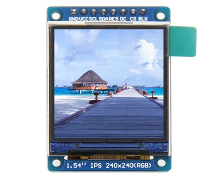
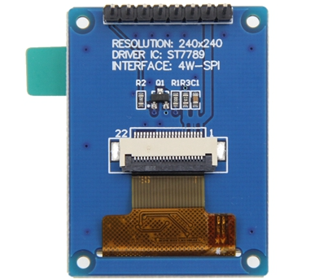
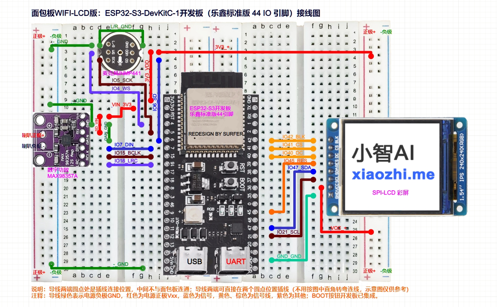
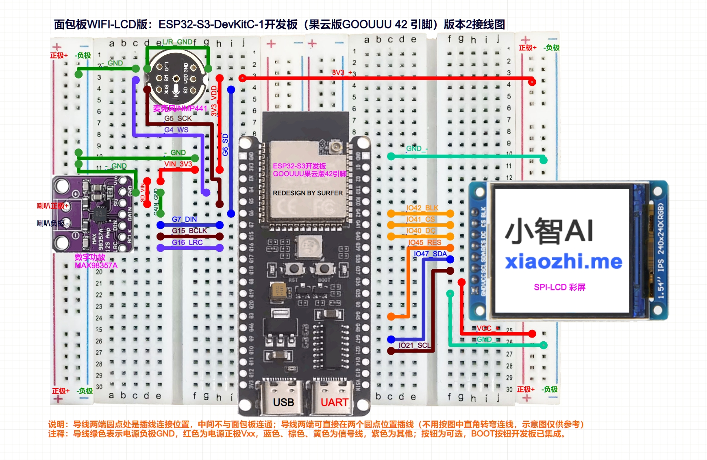
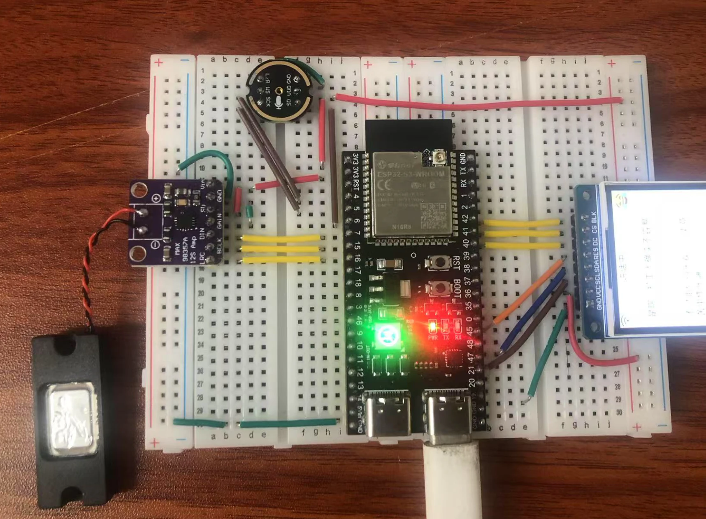

# 为 S3 面包板连接 SPI 彩屏

本页适用于 `bread-compact-wifi-lcd` 的分离 I2S 接线。它沿用基础 S3 的音频引脚，显示改为 SPI LCD；摄像头版是另一套配置。

## 1. 识别屏幕 {#scope}

准备支持所需电压的带驱动板 SPI 模块，核对驱动芯片、分辨率、CS、复位、背光和针脚数。屏幕背面的丝印比商品标题更重要。

<figure class="source-figure">

<figcaption>ST7789 屏幕正面。</figcaption>
</figure>

<figure class="source-figure">

<figcaption>原屏幕背面与接口丝印。</figcaption>
</figure>

v2.6.0 的该板默认构建是 **ST7789 240×320**，不是所有带 ST7789 标签的屏幕都使用这个尺寸。240×240、170×320 或无 CS 的七针屏，需选择/适配对应参数。

## 2. 按信号接线 {#wiring}

断电后连接，GPIO 按丝印识别，不按图片左右位置数针。

| 屏幕信号 | 当前板型 GPIO |
| --- | --- |
| SCL / SCK | GPIO21 |
| SDA / MOSI | GPIO47 |
| DC | GPIO40 |
| RES / RST | GPIO45 |
| CS | GPIO41 |
| BL / 背光控制 | GPIO42 |
| GND | 公共 GND |

电源输入与背光电路由模块规格决定：接口名 `VCC` 不证明它允许 5V，背光脚也不一定能直接由 GPIO 驱动。按模块原理图核对供电、使能和负载。

麦克风 WS/SCK/SD 对应 GPIO4/5/6，功放 DIN/BCLK/LRC 对应 GPIO7/15/16，参照[基础方案](../breadboard-esp32-s3)。不要保留 OLED 的 GPIO41/42 接线同时接彩屏。

## 44 针与 42 针的完整位置图 {#wiring-diagrams}

两张图的 LCD 信号与本页表一致，分别按自己的主板布局找 GPIO。**图中的屏幕为 240×240，默认构建为 240×320，需选择匹配的屏幕参数。功放 VIN 在图中接 3V3；采用基础 S3 的 USB 5V 方案时，按该方案处理功放供电和 SD/GAIN 设置。**

### 乐鑫标准版 · 44 针 {#layout-44}

<figure class="source-figure wiring-figure">

<figcaption>44 针标准板 SPI 彩屏总接线图（Surfer 标注），电源与屏幕尺寸差异见图前说明。点击查看大图。</figcaption>
</figure>

### GOOUUU 果云版 · 42 针 {#layout-42}

<figure class="source-figure wiring-figure">

<figcaption>42 针果云板 SPI 彩屏总接线图，按 GPIO 识别不同排针位置。点击查看大图。</figcaption>
</figure>

## 3. 构建与验证 {#build}

在[在线编译](../../firmware/online-builder)确认板型和该板提供的选项。需要其他屏幕参数时，在[本地环境](../../development/build-firmware)中对照[当前配置](https://github.com/78/xiaozhi-esp32/blob/4de00aed740595a8713b01f8332b9b2cf30685bc/main/boards/bread-compact-wifi-lcd/config.h)。

引脚改变或新增变体应使用[独立构建身份](../../development/custom-board)。需要维护 v2.0.2/v2.2.6 设备时使用相应版本，不能把它们当作当前构建。

## 完成效果与检查 {#verify}

LCD 与音频模块的整体装配如下，可对照主控、屏幕和喇叭的相对位置：

<figure class="source-figure">

<figcaption>原彩屏面包板的完成实物，屏幕尺寸、方向与参数按自己的模块核对。点击查看大图。</figcaption>
</figure>

### 怎么确认完成

屏幕完整显示、方向和颜色正确，背光可控；提示音、麦克风和一轮对话正常。只亮背光时先检查 SPI/复位/CS 和驱动；图像偏移、裁边时检查分辨率、偏移、镜像与 SPI 模式，而不是随机换引脚。

## 下一步 {#next}

继续[配网与绑定](../../getting-started/wifi-and-binding)。需要图像识别时使用[摄像头专用方案](../breadboard-camera)，不要直接叠加它的引脚。
