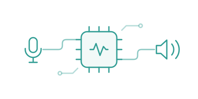

# 教程与帮助

直接打开你需要的教程，或搜索硬件型号和遇到的问题。

- [配网与绑定](./getting-started/wifi-and-binding.md)
- [在线编译与烧录](./firmware/online-builder.md)
- [固件下载](./firmware/releases/v2.6.0.md#download)
- [S3 面包板搭建](./hardware/breadboard-esp32-s3.md)
- [故障排查](./faq/index.md)

##  [快速开始](./getting-started/index.md) {#getting-started}

- [第一次使用：从这里开始](./getting-started/index.md)
- [配网与绑定设备](./getting-started/wifi-and-binding.md)

##  [固件与下载](./firmware/index.md) {#firmware}

- [在线编译与网页烧录](./firmware/online-builder.md)
- [下载与选择固件](./firmware/downloads.md)
- [烧录与升级](./firmware/flashing.md)
- [v2.6.0 正式固件](./firmware/releases/v2.6.0.md)
- [v1.9.4 历史固件](./firmware/releases/v1.9.4.md)

##  [硬件与接线](./hardware/index.md) {#hardware}

- [如何选择第一套硬件](./hardware/choosing-hardware.md)
- [支持的板型与变体](./hardware/supported-boards.md)
- [基础 ESP32-S3 面包板](./hardware/breadboard-esp32-s3.md)
- [ESP32-C3 面包板](./hardware/breadboard-esp32-c3.md)
- [经典 ESP32 面包板](./hardware/breadboard-esp32.md)
- [ST7789 彩屏](./hardware/displays/st7789.md)
- [4G 面包板：ML307R / NT26K](./hardware/breadboard-4g.md)
- [S3 摄像头面包板](./hardware/breadboard-camera.md)
- [Xmini-C3 与 V3](./hardware/boards/xmini-c3.md)
- [外接 ASR 唤醒模块](./hardware/external-wake-module.md)
- [电池供电与充电](./hardware/battery-power.md)
- [扬声器、耳机与音箱](./hardware/audio-output.md)
- [硬件设计要点](./hardware/design-guidelines.md)

##  [控制台设置](./console/index.md) {#console}

- [配置角色、模型与声音](./console/index.md#role-and-voice)
- [声纹识别](./console/index.md#speaker-recognition)
- [GitHub 认证与权益](./console/github-verification.md)
- [声音复刻](./console/voice-cloning.md)
- [知识库](./console/knowledge-base.md)

##  [MCP 与工具扩展](./mcp/index.md) {#mcp}

- [MCP 快速开始](./mcp/quickstart.md)
- [连接已有 MCP 服务](./mcp/connect-existing-servers.md)
- [联网搜索示例](./mcp/examples/web-search.md)

##  [固件开发](./development/index.md) {#development}

- [搭建环境与本地构建](./development/build-firmware.md)
- [修改引脚与自定义板型](./development/custom-board.md)
- [音频处理与 AEC](./development/audio-and-aec.md)
- [唤醒词与识别方案](./development/wake-words.md)
- [用 MCP 控制 GPIO](./development/mcp-gpio.md)
- [提示音与语言资源](./development/custom-prompts.md)
- [P3 提示音历史方案](./development/archive/p3-prompts.md)

##  [协议与参考](./reference/index.md) {#reference}

- [WebSocket 版本入口](./reference/websocket.md)
- [OTA、激活与更新](./reference/ota.md)
- [心情与表情显示](./reference/display-emotions.md)

##  [常见问题](./faq/index.md) {#faq}

- [电脑找不到设备 / 烧录失败](./faq/index.md#serial)
- [无法启动 / 反复重启](./faq/index.md#boot)
- [无法配网 / 连接网络](./faq/index.md#network)
- [设备码 / 账号归属](./faq/index.md#account)
- [声音 / 麦克风 / 唤醒](./faq/index.md#audio)
- [黑屏 / 显示不正常](./faq/index.md#display)
- [本地编译报错](./faq/index.md#build)
- [MCP 工具未出现 / 调用失败](./faq/index.md#mcp)
- [登录、账号与解绑](./faq/account-and-binding.md)
- [获取串口日志](./faq/serial-logs.md)

##  [社区与贡献](./community/index.md) {#community}

- [开源硬件项目](./community/open-hardware.md)
- [SF32LB52 教程 ↗](https://openkits-wiki.easyeda.com/zh-hans/hspi-sf32lb52/training/xiaozhi-ai/)
- [太空人故事机改造](./community/projects/astronaut-storyteller.md)
- [网络唤醒电脑](./community/projects/wake-on-lan.md)
- [社区 MCP 工具](./community/mcp-tools.md)
- [音乐、歌词与资源](./community/resources.md)
- [参与文档贡献](./community/contributing.md)

发现步骤、接线或翻译有误？使用文章底部的反馈入口，或[参与文档维护](./community/contributing.md)。
