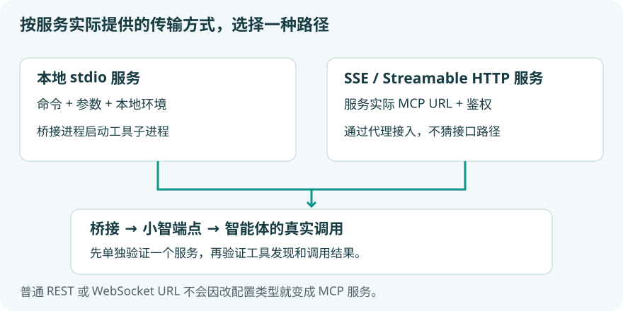

# 桥接已有 MCP 服务

已经有 MCP 服务时，不必再把它改写成另一个工具程序。先确定它的传输方式和独立运行结果，再接入小智端点。

<a name="scope"></a>

## 开始前 {#scope}

先完成[MCP 快速开始](./quickstart.md)，确认自己的小智端点能接入一个最小工具。本页沿用其中固定提交的 `mcp_pipe.py` 和 Python 环境，区别在于它读取多个服务的配置。

| 服务类型 | 连接信息 |
| --- | --- |
| stdio | 本机命令、参数、工作文件及环境变量 |
| SSE | 服务明确提供的 SSE URL 与所需鉴权 |
| Streamable HTTP | 服务明确提供的 HTTP MCP URL 与所需鉴权 |

普通 REST API 或 WebSocket 地址不能仅靠改 `type` 就变成 MCP 服务。

<figure class="source-figure">

[](../../public/images/zh/mcp-transport-choice.svg)

<figcaption>已有 MCP 服务先选正确的传输方式。点击查看大图。</figcaption>
</figure>

<a name="standalone"></a>

## 1. 先独立验证服务 {#standalone}

使用服务维护者支持的 MCP 客户端或测试方法确认 `initialize`、工具发现和一次调用成功。固定软件版本，知道它会访问哪些文件、设备或远端账号。

本地文件工具只开放需要的目录；Home Assistant 等服务的令牌只授予所需范围。不要直接复制含真实路径、Token 和管理员权限的整份别人的配置。

<a name="config"></a>

## 2. 建立配置 {#config}

在桥接目录创建 `mcp_config.json`。以下是结构示例，所有占位命令、路径和 URL 都要换成真实服务：

```json
{
  "mcpServers": {
    "local-tool": {
      "type": "stdio",
      "command": "python",
      "args": ["/absolute/path/to/your_server.py"]
    },
    "remote-tool": {
      "type": "http",
      "url": "https://mcp.example.com/mcp",
      "headers": {"Authorization": "Bearer REPLACE_LOCALLY"}
    }
  }
}
```

SSE 服务把 `type` 改为 `sse` 并使用它的真实地址。不能凭习惯猜 `/sse` 或 `/mcp` 路径；`disabled: true` 可用于暂时跳过一个服务。示例凭据仅在本地替换，不提交带真实密钥的配置。

<a name="run"></a>

## 3. 启动并分段检查 {#run}

在同一终端设置 `MCP_ENDPOINT` 后，不带脚本参数运行：

```sh
python mcp_pipe.py
```

该上游提交读取配置并为启用项建立桥接；HTTP/SSE 通过环境中安装的 `mcp-proxy` 连接。为了定位问题，先只开启一个服务，逐个验证再增加。

若带本地 Python 脚本参数，则按快速开始运行单脚本，不把配置项名字误当成脚本路径。

<a name="verify"></a>

## 怎么确认完成 {#verify}

目标智能体发现预期工具，并在对话记录中实际调用成功。验证服务重启和断网恢复；不要以桌面客户端能列出工具代替小智端的调用结果。

<a name="materials"></a>

## 第三方图形工具与素材 {#materials}

HyperChat、McpPipe 等工具可以管理网关和连接，具体安装与版本由作者维护。选型见[社区 MCP 工具](../community/mcp-tools.md)。

### 文件管理与 Home Assistant 从哪里开始

- **文件管理**：使用 [MCP 官方 filesystem 服务说明](https://github.com/modelcontextprotocol/servers/tree/main/src/filesystem)，安装要求的 Node.js，在 stdio 参数里明确允许访问的目录。先用一个专门的测试目录验证列表/读取，不直接开放整个用户目录。
- **Home Assistant**：按 [Home Assistant 的 MCP 服务端指南](https://www.home-assistant.io/integrations/mcp_server/)取得实际 MCP URL、配置授权和可暴露的实体/工具，再选择支持其传输与鉴权的桥接器。Home Assistant 的“MCP Client”方向相反，不能替代服务端配置。
- **图形网关**：按[HyperChat / McpPipe 步骤](../community/mcp-tools.md#bridge-tools)连接，分清远端网关 URL 与小智端点。

先完成服务本身的一次测试，再回到本文配置文件。工具安装成功不等于已经向目标智能体暴露。

<a name="next"></a>

## 下一步 {#next}

搜索用例见[联网搜索](./examples/web-search.md)，固件内控制设备走[设备端 GPIO 工具](../development/mcp-gpio.md)。桥接行为以[本篇采用的上游版本](https://github.com/78/mcp-calculator/tree/c537f71d61fd73b47d6c8955b5df6d3721acf4e4)为准。
