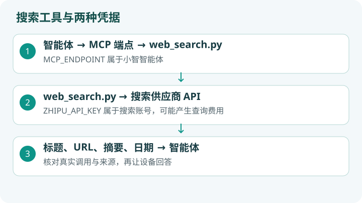

# 为智能体接入联网搜索

先接通最小 MCP 工具，再加搜索供应商。搜索工具应返回标题、来源链接和摘要，不把搜索结果直接当成已验证的事实。

## 准备工作 {#scope}

完成[MCP 快速开始](../quickstart)，使用其中的 Python 环境和桥接目录。准备自己有权使用的搜索服务账号，确认当前费用与额度。

这里以智谱 Web Search API 为具体示例，接口和参数按[供应商官方文档](https://docs.bigmodel.cn/cn/guide/tools/web-search)。调用搜索服务可能计费，使用前确认账号的当前价格与额度。

<figure class="source-figure">

[](../../../public/images/zh/mcp-web-search-flow.svg)

<figcaption>搜索工具与两种凭据。点击查看大图。</figcaption>
</figure>

## 1. 保存示例程序 {#code}

新建 `web_search.py`，使用以下代码；也可从[文档仓库示例](https://github.com/78/xiaozhi-docs/blob/main/examples/mcp/web_search.py)取得同一份程序。

<<< ../../../../examples/mcp/web_search.py

## 2. 设置供应商凭据 {#credentials}

在启动桥接的同一个终端配置，按自己的实际账号替换占位值：

::: code-group

```powershell [PowerShell]
$env:ZHIPU_API_KEY = '在本地填写自己的搜索服务密钥'
```

```sh [macOS / Linux]
export ZHIPU_API_KEY='在本地填写自己的搜索服务密钥'
```

:::

沿用快速开始安装的 `mcp` 与 `httpx` 等依赖；缺少时在同一虚拟环境安装。MCP 端点和搜索服务密钥是两种凭据，不要互换。

## 3. 启动并核对结果 {#verify}

设置自己的 `MCP_ENDPOINT` 后运行：

```sh
python mcp_pipe.py web_search.py
```

在同一智能体刷新工具列表，确认出现 `web_search`，再要求“请联网查询某个明确问题，并给出来源”。检查实际工具调用、标题、URL、摘要和结果日期；模型直接回答不等于发生了搜索。

返回的网页内容只当资料，不当作执行命令、修改权限或泄露凭据的指令。发生 401/403、限额、超时或空结果时先区分供应商响应与 MCP 连接问题。

## 其他接入方式 {#materials}

需要桌面启动器或托管搜索时，可查看[社区工具](../../community/mcp-tools)。下方的 Python GUI 示例属于历史代码；本页维护的最小示例是上面的 `web_search.py`。

<SourceMaterials article="DOC-25" />

## 下一步 {#next}

希望使用现成远端 MCP 时看[桥接已有服务](../connect-existing-servers)。无论选哪家供应商，先限制查询与返回体，记录计费和来源，再扩大使用范围。
